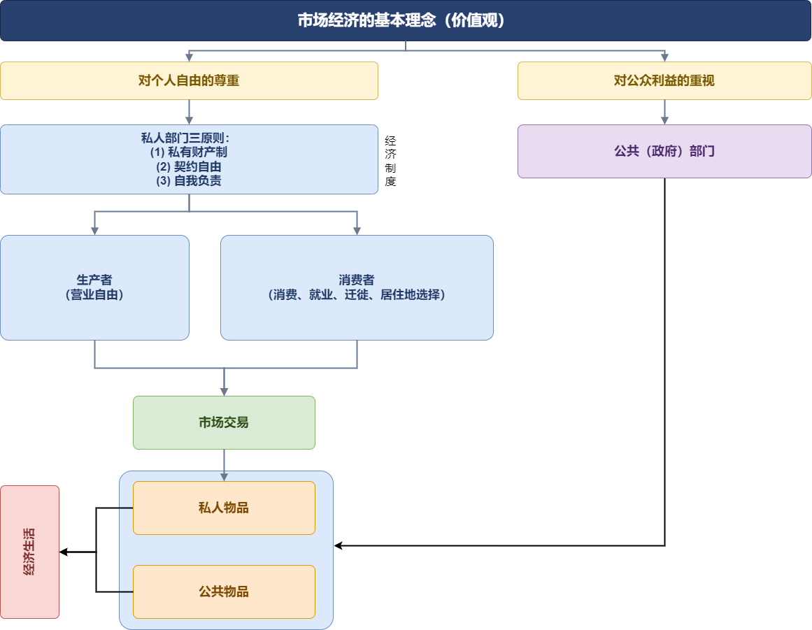

# 微观经济学

## 一、经济学的研究方法

### 市场经济的基本理念

## 二、供求关系

### 理性人假设

理性人：**每一经济个体都力图以最小代价实现最好结果，即尽力实现“趋利避害”**。

道德引导人们通过利他来自利：褒奖利他的自私行为，贬低不利他的自私行为，谴责损人的自私行为。

法律用刑罚禁止自私的人做损人的事。

市场用价格引导自私的人做利他的事。

### 从支付意义到需求

