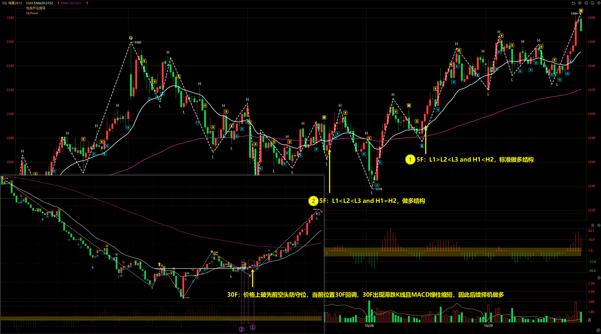
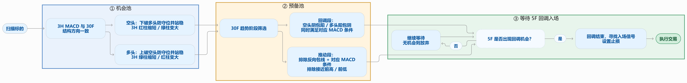
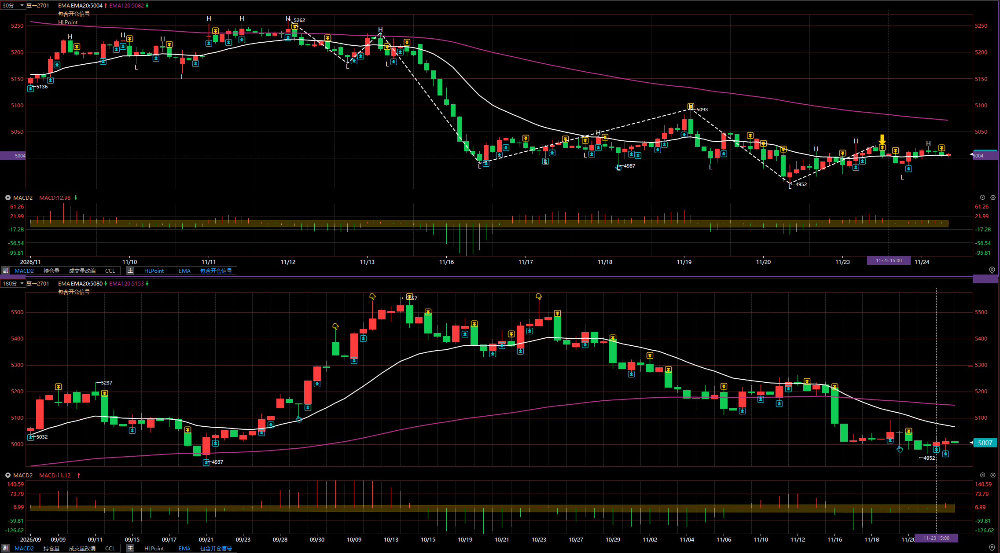
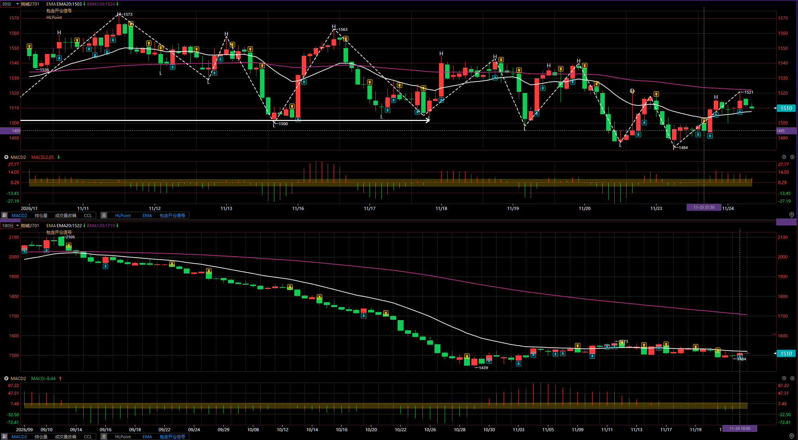
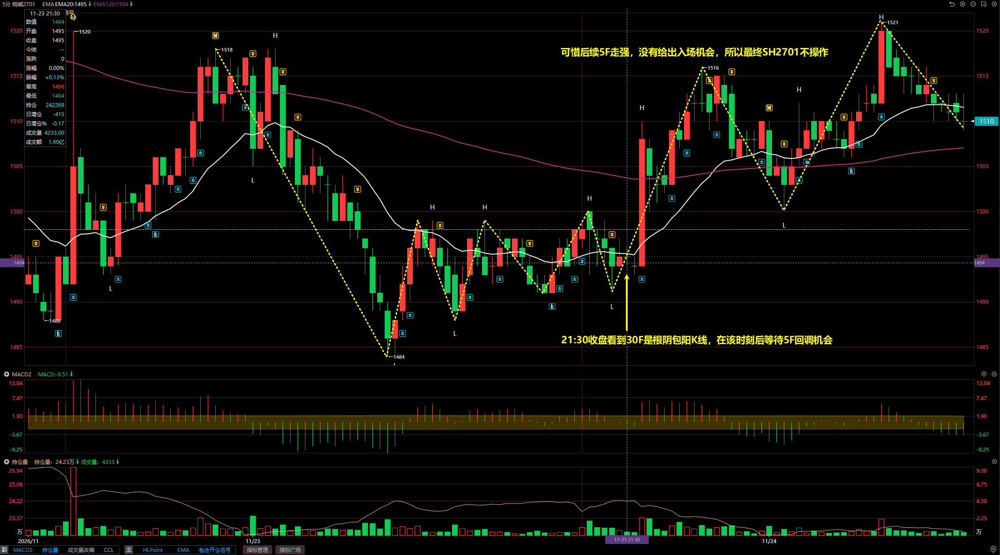

# 回调入场结构所面临的问题

## 30F 回调的现实情况分类

当前 30F 是多头趋势，30F 线段为下跌段，也是多头趋势回调段，那么正常来说是去 5F 结构判断这个 30F 回调段何时结束，然后择机做多。但在现实市场中，往往会出现不同的预期：

1.正常预期：5F 经过调整，给出了 5F 回调机会入场机会，此时在该回调位置择机做多。

2.提前入场：入场后 30F 回调还未结束

如图是鸡蛋 2612 合约走势图，30F 可以看到 ①② 均出现阳包阴 K 线且 MACD 绿柱缩短的信号。切换到 5F 周期，在 ① 处入场就是正常走出预期；在 ② 处入场会触发止损。

3.出现 5F 回调机会，也入场了，但力量很弱，30F 的新上涨段没走多远就又下跌了。

如图是烧碱 2701 合约走势图，30F 可以看到 ①② 均出现阳包阴 K 线且 MACD 绿柱缩短的信号。切换到 5F 周期，在 ① 处入场 30F 回调没有结束，则会触发止损；在 ② 处入场可以看到 30F 上涨预期非常弱，出现滞涨 K 线就上不去了，此时看到 30F 的 K 线就保本离场。

4.不给 5F 回调入场机会，而是直接上涨。

如图是沪深 300 2703 合约走势图，30F 可以看到出现阴包阳 K 线且 MACD 红柱缩短的信号。切换到 5F 周期，是没有入场机会的，直接顺畅下跌。

5.30F 的回调段没有达成结束后开启上涨的预期，反而直接延续变成新的空头趋势推动段了。

## 回调入场的标准

① 机会池：**当且仅当 3H 的 MACD 显示和 30F 的结构判定相同**，将标的加入机会池。

3H 的 MACD 红柱缩短或绿柱变大，同时 30F 的结构为空头结构才加入机会池，而空头结构的要求标准是必须下破多头防守位并站稳。

3H 的 MACD 绿柱缩短或红柱变大，同时 30F 的结构为多头结构才加入机会池，而多头结构的要求标准是必须上破空头防守位并站稳。

② 预备池：从机会池筛选的标的，当前标的 30F 必然是趋势回调段或趋势推动段。

以空头趋势为例：

- 趋势回调段：**<u>阴包阳</u>** and (**<u>MACD 红柱缩短至黄色区域内 or MACD 绿柱变大</u>**)，进入预备池
- 趋势推动段：除了下面 2 种情况，都能进入预备池
  - 阳包阴 and (MACD 绿柱缩短至黄色区域内 or MACD 红柱变大)，不进入预备池
  - 价格离前低非常近，不进入预备池

以多头趋势为例：

- 趋势回调段：**<u>阳包阴</u>** and（**<u>MACD 绿柱缩短至黄色区域内 or MACD 红柱变大</u>**），进入预备池。
- 趋势推动段：除了下面 2 种情况，都能进入预备池：
  - 阴包阳 and（MACD 红柱缩短至黄色区域内 or MACD 绿柱变大），不进入预备池；
  - 价格离前高非常近，不进入预备池。

③ 等待 5F 回调入场机会

某些进入预备池的标的，可能没有 5F 回调上车机会，那这种就不是操作的目标。**要操作的一定是有 5F 回调的，回调入场往往会更容易设置止损位置**，所以在看到标的进入预备池后，往往还需要等待一段时间，在 5F 给出入场机会才能操作。

## 范例

### 正面范例

### 错误范例

#### 2026/11/23 a2701

① 机会池：3H 的 MACD 绿柱缩小，30F 为空头结构，不符合进入机会池标准。

3H显示空头衰竭，但30F仍旧是空头结构，此时不应该操作。

#### 2026/11/23 SH2701

① 机会池：3H 的 MACD 绿柱变大，30F 为空头结构，所以符合进入机会池。

② 预备池：30F 为趋势回调段，出现阴包阳 K 线同时 MACD 红柱较短，所以符合进入预备池。

③ 5F 等回调

21:30 收盘看到 30F 是根阴包阳 K 线，在该时刻后等待 5F 回调机会。可惜后续 5F 走强，没有给出入场机会，所以最终 SH2701 不操作。

