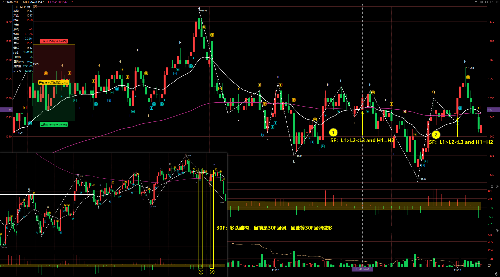
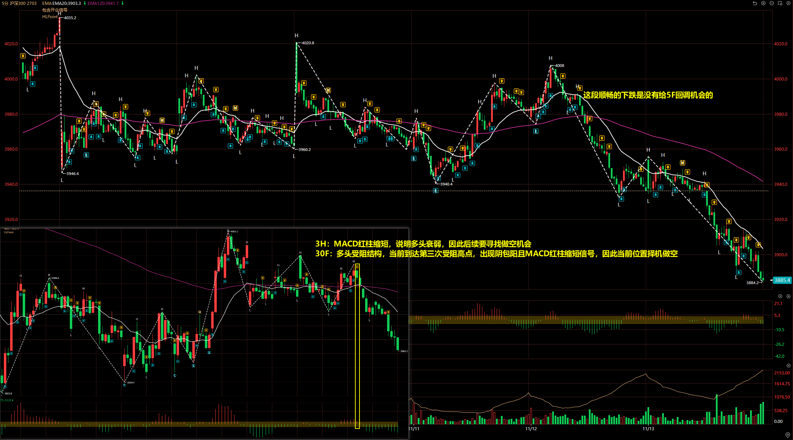

# 回调入场结构所面临的问题

## 30F 回调的现实情况分类

当前 30F 是多头趋势，30F 线段为下跌段，也是多头趋势回调段，那么正常来说是去 5F 结构判断这个 30F 回调段何时结束，然后择机做多。但在现实市场中，往往会出现不同的预期：

1.正常预期：5F 经过调整，给出了 5F 回调机会入场机会，此时在该回调位置择机做多。

2.提前入场：入场后 30F 回调还未结束

如图是鸡蛋 2612 合约走势图，30F 可以看到 ①② 均出现阳包阴 K 线且 MACD 绿柱缩短的信号。切换到 5F 周期，在 ① 处入场就是正常走出预期；在 ② 处入场会触发止损。

3.出现 5F 回调机会，也入场了，但力量很弱，30F 的新上涨段没走多远就又下跌了。

如图是烧碱 2701 合约走势图，30F 可以看到 ①② 均出现阳包阴 K 线且 MACD 绿柱缩短的信号。切换到 5F 周期，在 ① 处入场 30F 回调没有结束，则会触发止损；在 ② 处入场可以看到 30F 上涨预期非常弱，出现滞涨 K 线就上不去了，此时看到 30F 的 K 线就保本离场。

4.不给 5F 回调入场机会，而是直接上涨。

如图是沪深 300 2703 合约走势图，30F 可以看到出现阴包阳 K 线且 MACD 红柱缩短的信号。切换到 5F 周期，是没有入场机会的，直接顺畅下跌。

5.30F 的回调段没有达成结束后开启上涨的预期，反而直接延续变成新的空头趋势推动段了。

