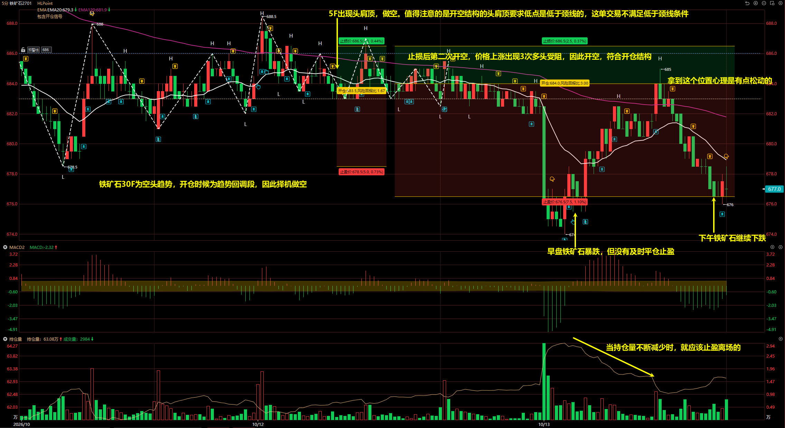
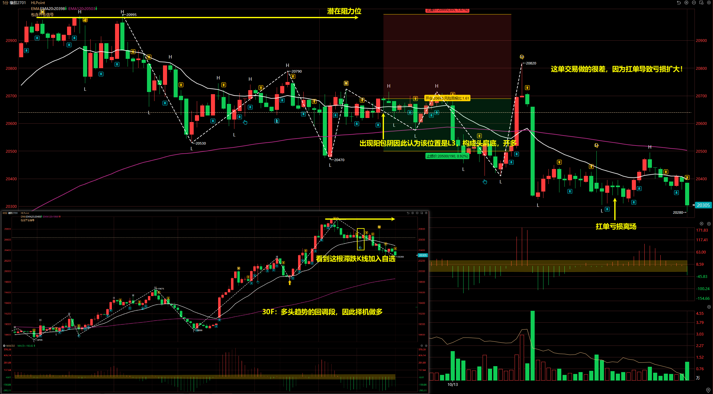
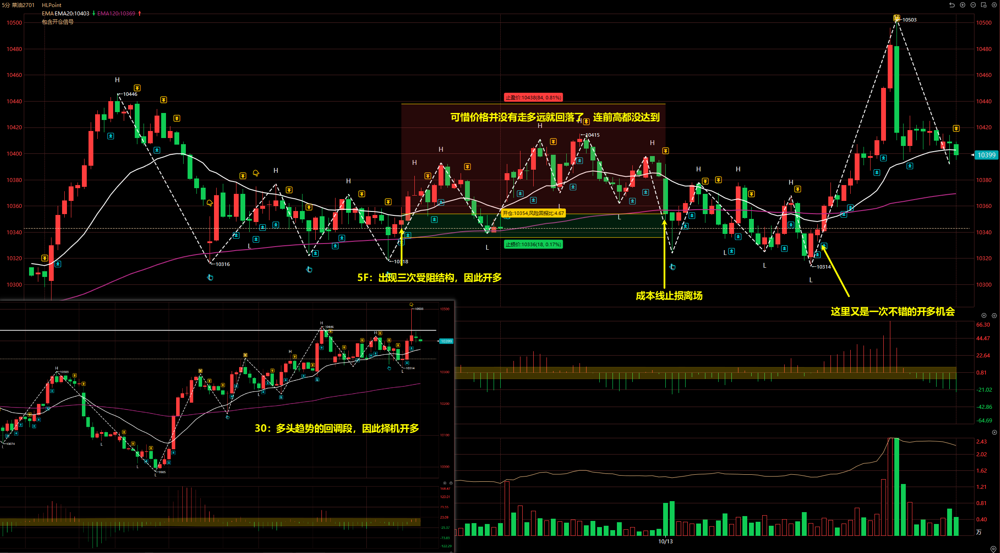
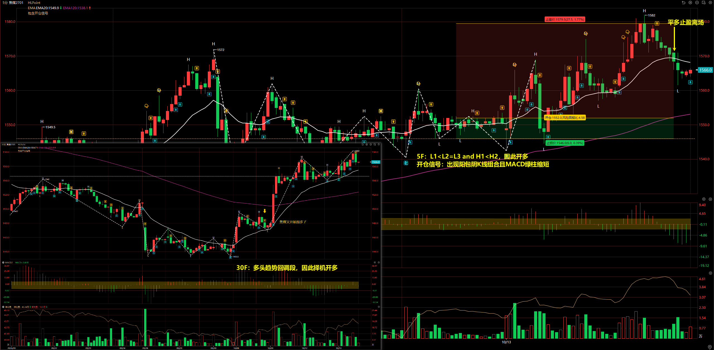
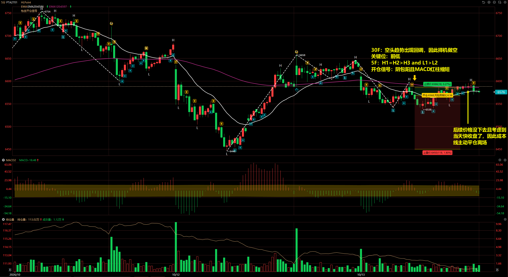

# 2026/10/13

## 铁矿石 2701

30F：空头趋势，开仓时候为趋势回调段，因此择机做空

关键位：距离前低有一段较远距离。

5F：

- 第一次：5F 出现头肩顶，做空。
- 第二次：止损后第二次开空，价格上涨出现 3 次多头受阻，因此开空，符合开仓结构。

开仓信号：阴包阳，MACD 红柱缩短。

::: danger

值得注意的是开空结构的头肩顶要求低点是低于颈线的，这单交易不满足低于颈线条件。

:::

早盘铁矿石暴跌，但没有及时平仓止盈，下午铁矿石继续下跌才主动止盈。

**当第一次持仓量不断减少时，就应该止盈离场的。** 然后回撤后下午继续开空，再次操作。

## 橡胶 2701

30F：多头趋势的回调段，因此择机做多

关键位：前高

5F：头肩底

开仓信号：出现阳包阴因此认为该位置是 L3。

::: danger

值得注意的是开多结构的头肩底要求高点是高于颈线的，这单交易不满足高于颈线条件。

:::

**这单交易做的很差，因为扛单导致亏损扩大！** 最终扛单亏损离场。

## 菜油 2701

30F：多头趋势的回调段，因此择机做多

5F：三次受阻结构，因此开多

开仓信号：出现阳包阴 K 线组合且 MACD 绿柱缩短

## 焦煤 2701

30F：多头趋势的回调段，因此择机做多

5F：L1 < L2 = L3 and H1 < H2，符合开多结构

开仓信号：出现阳包阴 K 线组合且 MACD 绿柱缩短

## PTA 2701

30F：空头趋势的回调段，因此择机做空

关键位：前低

5F：H1 = H2 > H3 and L1 > L2，符合开空结构

开仓信号：阴包阳且 MACD 红柱缩短

