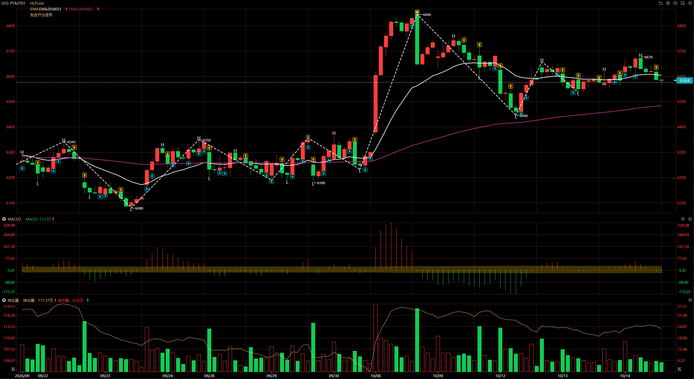
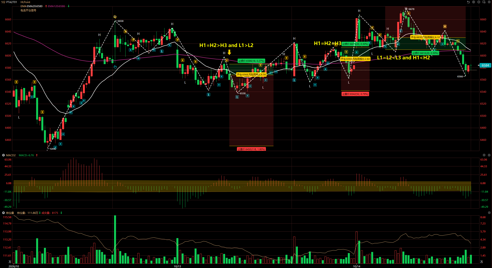

# 2026/10/14

## PTA 2701

这是 PTA 最近的 30F 图，整体是多头趋势，因此正常来说应该是等 30F 回调做多。但这次并没有根据结构判定，导致 30F 方向看法不对。

30F 方向判定要依赖于结构，而非意想其为某个方向。

::: danger

**除非遇到特别明确的新闻消息，大级别操作方向都是依赖于结构判定规则。**

:::

如果单独看 5F，每次开仓都是有依据的：

- 第一次：H1 = H2 > H3 and L1 > L2，符合做空结构
- 第二次：H1 = H2 = H3，符合多头三次受阻结构，可做空
- 第三次：L1 = L2 < L3 and H1 < H2，符合做多结构

但结合 30F 去看，30F 就是做多预期，那么第三次做多是对的，然后会有一次潜在空头三次受阻的做多机会。

另外关于止盈的思考，我觉得止盈暂时可以定为持仓 5F 线段目标，即出现反包 K 线且 MACD 红绿柱缩短，就可以止盈了。这是为了做期货模拟考核避免大幅回撤的，随后该标的经过 5F 回调调整，可再次入场。

