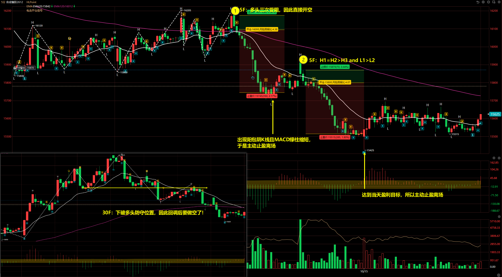
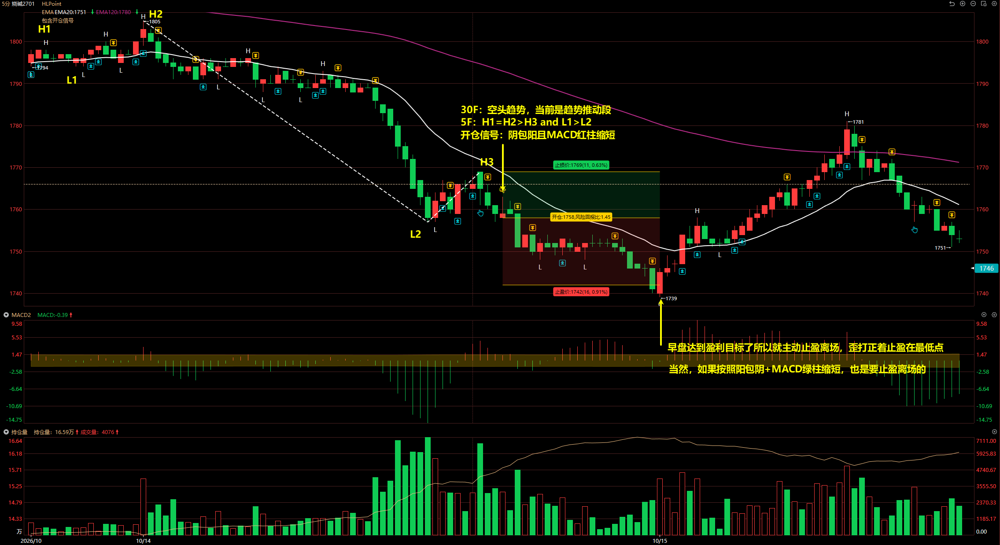
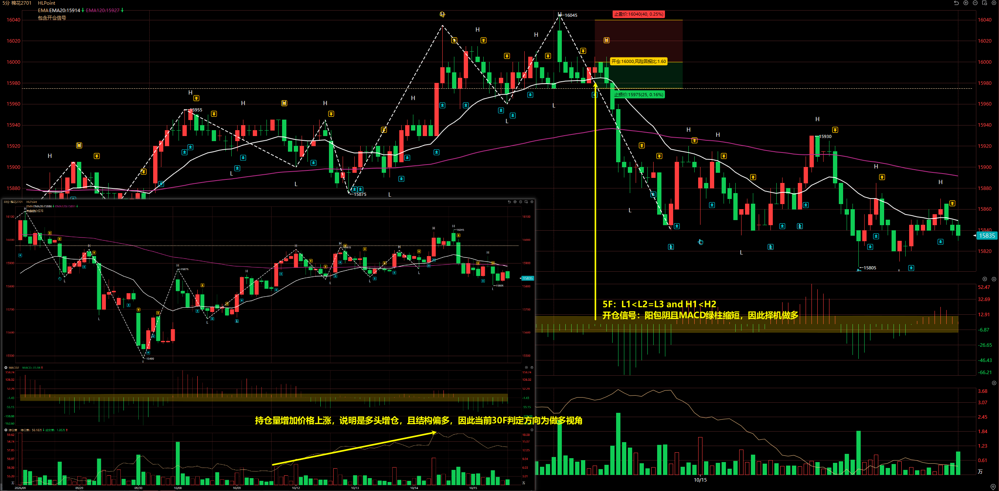
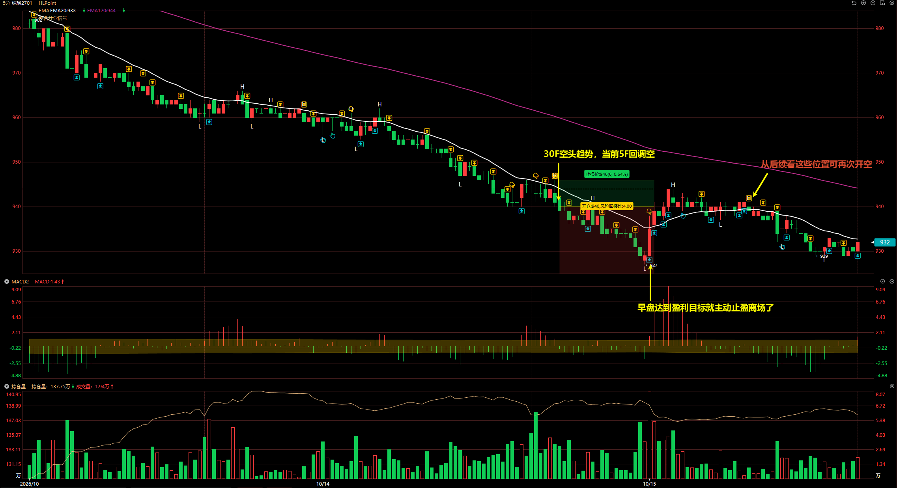
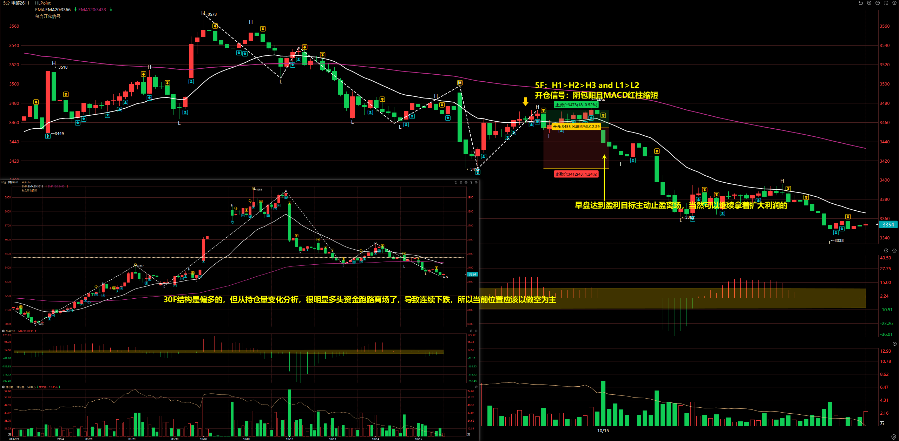

# 2026/10/15

## 合成橡胶 2612

30F：下破多头防守位置，因此回调后开空。

5F：

- 第一次：多头三次受阻，因此直接开空
- 第二次：H1 = H2 > H3 and L1 > L2

开仓信号：阴包阳且 MACD 红柱缩短

当持仓的空单出现阳包阴且 MACD 绿柱缩短，主动止盈离场，目标持仓是 5F 线段。后续回调出现新的机会再次入场。

## 烧碱 2701

30F：空头趋势，当前是趋势推动段，因此内部 5F 回调择机做空

5F：H1 = H2 > H3 and L1 > L2

开仓信号：阴包阳且 MACD 红柱缩短

## 棉花 2701

30F：结构偏多，且持仓量增加价格上涨，说明是多头增仓，因此 30F 判定方向为做多视角

5F：L1 < L2 = L3 and H1 < H2

开仓信号：阳包阴且 MACD 绿柱缩短，因此择机做多。

这单最后很可惜，没有走出预期，哪怕有持仓量匹配的加持，仍旧走出了下跌。

## 纯碱 2701

30F 空头趋势，当前 5F 回调空。

::: danger

这单交易的开仓手数有问题，开少了，应该是 35 * 5 = 175 手

:::

## 甲醇 2611

30F 结构是偏多的，但从持仓量变化分析，很明显多头资金跑路离场了，导致连续下跌，所以当前位置应该以做空为主。

5F：H1 > H2 > H3 and L1 > L2

开仓信号：阴包阳且 MACD 红柱缩短

::: danger

当持仓量显示和价格结构分析相悖时，一般情况还是以价格结构为主，但如果持仓量有非常明显的特征，还是以持仓量为主。

当前的甲醇可以观察到持仓量不断变少，说明多头资金跑路离场导致的下跌，所以此时做多肯定是不对的。

:::

