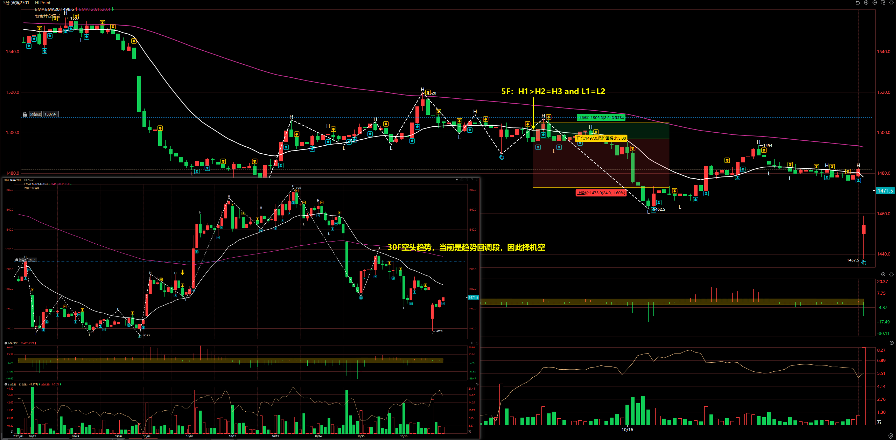
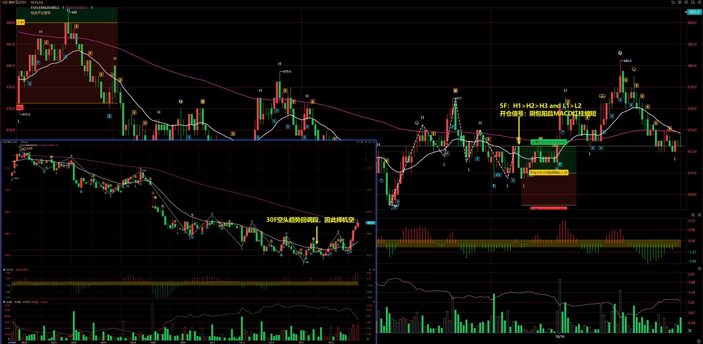
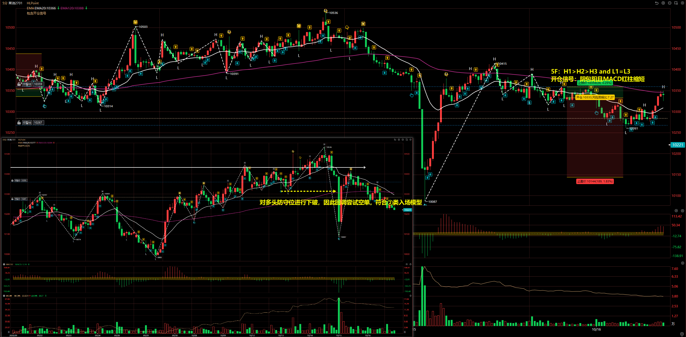

# 2026/10/16

## 焦煤 2701

30F：结构偏空，当前是趋势回调段，因此择机做空

5F：H1 > H2 = H3 and L1 = L2

开仓信号：阴包阳且 MACD 红柱缩短，因此择机做空。

## 铁矿石 2701

30F：结构偏空，当前是趋势回调段，因此择机做空

5F：H1 > H2 > H3 and L1 > L2

开仓信号：阴包阳且 MACD 红柱缩短

其实当 30F 出现阳包阴且 MACD 绿柱缩短的时候，就应该小心持仓的空单，这单交易是有小幅扛单的。

## 菜油 2701

30F：对多头防守位进行下破，因此回调尝试空单，符合 ② 类入场模型

5F：H1 > H2 > H3 and L1 = L3

开仓信号：阴包阳且 MACD 红柱缩短

::: danger

这单交易的开仓手数是错误的，500 万资金应该开仓 75 手，这次操作错误开仓了 150 手。

:::

