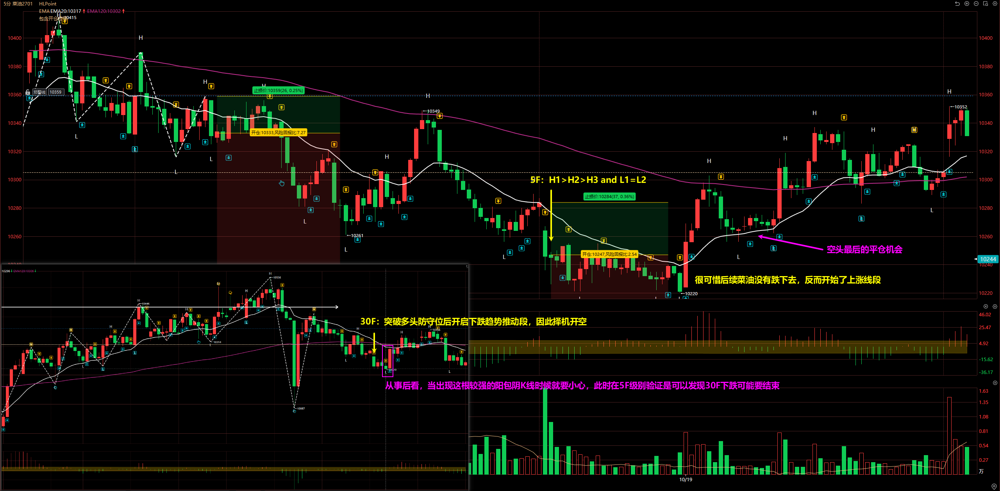
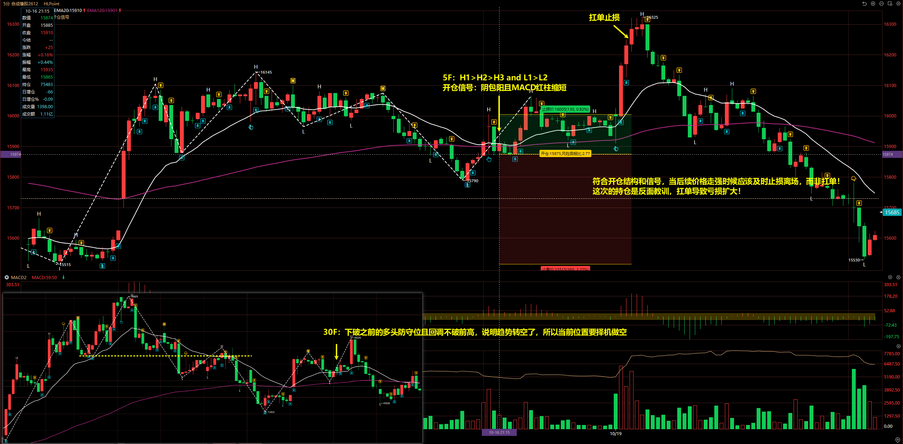
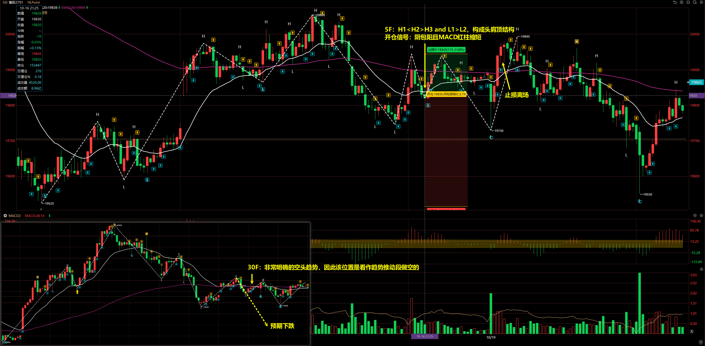
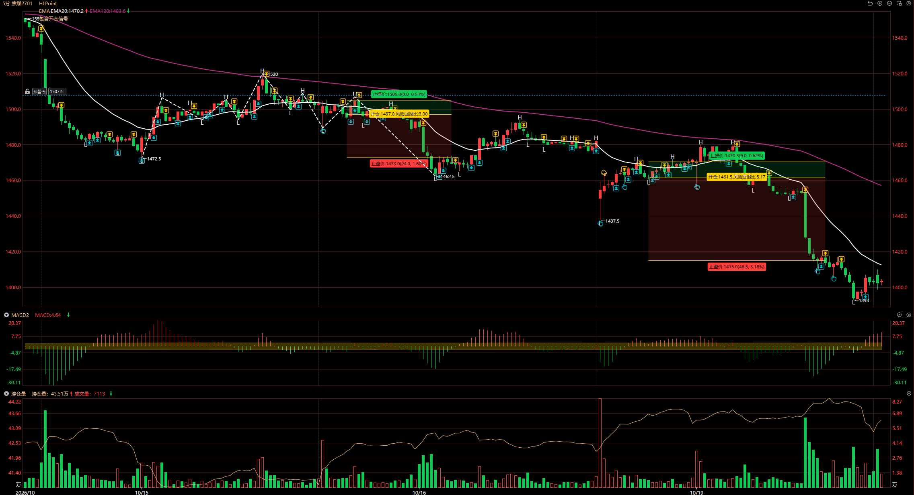
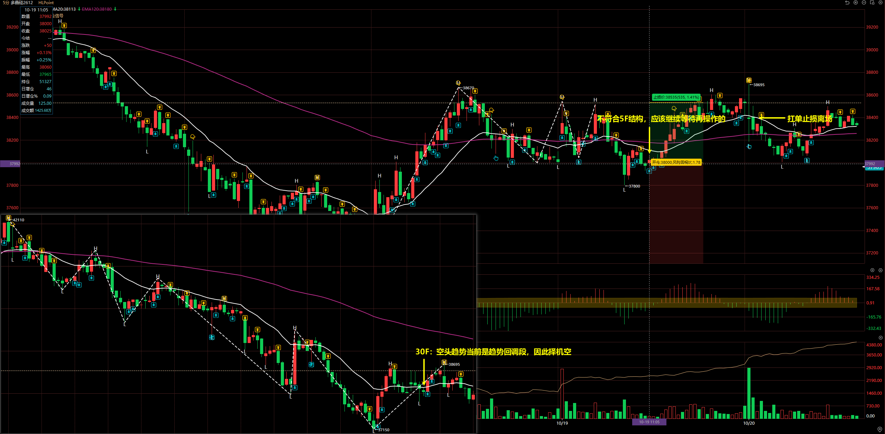
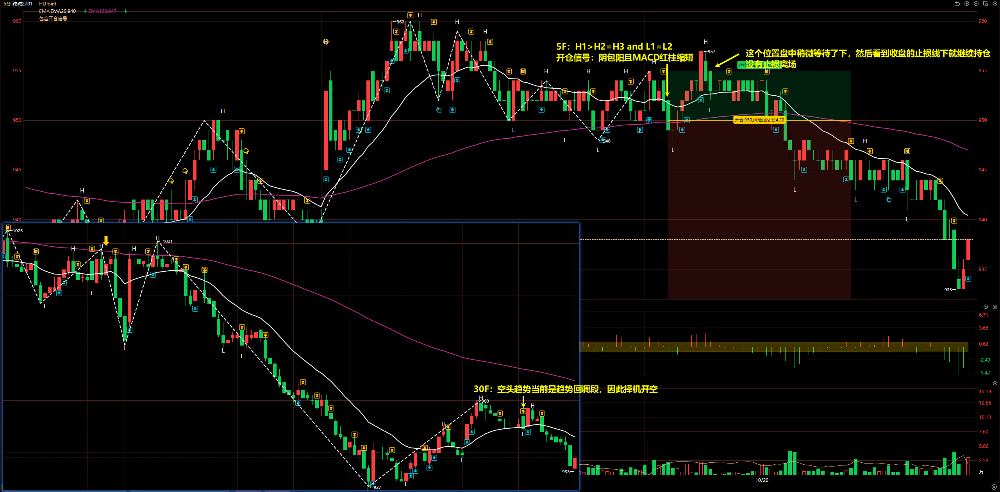
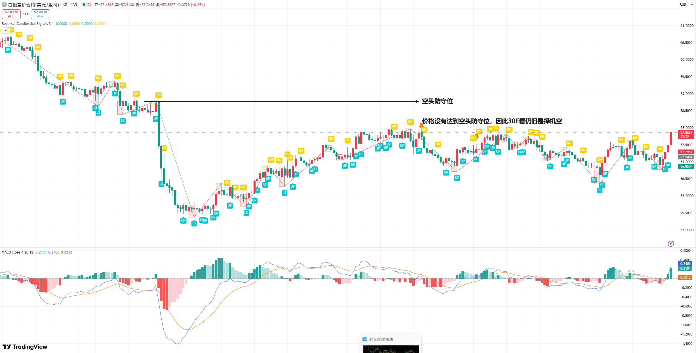
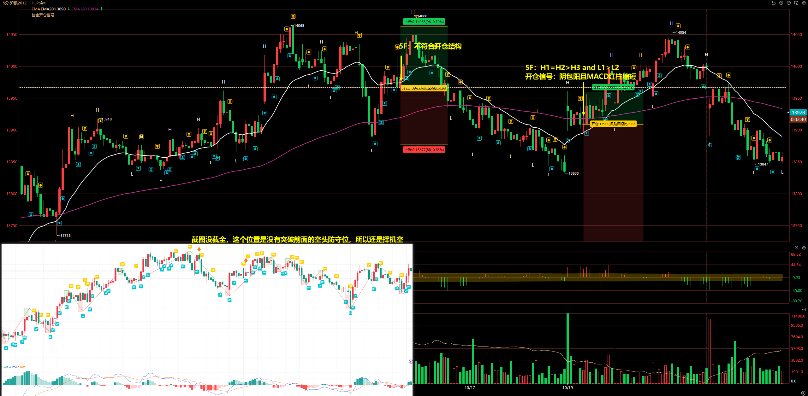
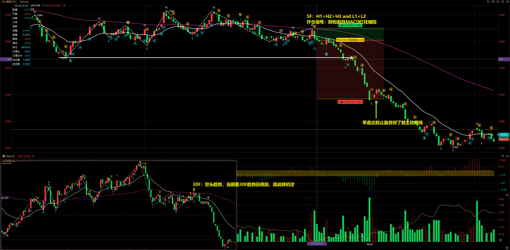
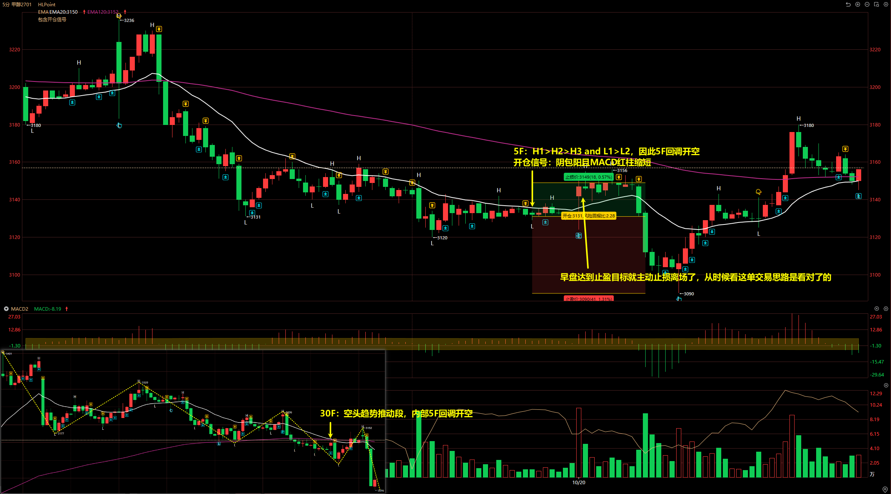

# 2026/10/20

由于 10/19 有不少单子没有盘后平仓，所以是在 10/20 写的日志。

## 菜油 2701

30F：突破多头防守位后开启下跌趋势推动段，因此择机开空

5F：H1 > H2 > H3 and L1 = L2

开仓信号：阴包阳且 MACD 红柱缩短

从事后看，当出现较强的阳包阴 K 线时候就要小心，此时在 5F 级别结构验证是可以发现 30F 下跌可能要结束。

## 合成橡胶 2612

30F：下破之前的多头防守位且回调不破前高，说明趋势转空了，所以当前位置要择机做空

5F：H1 > H2 > H3 and L1 > L2

开仓信号：阴包阳且 MACD 红柱缩短

::: danger

符合开仓结构和信号，当后续价格走强时候应该及时止损离场，而非扛单！

这次的持仓是反面教训，扛单导致亏损扩大！

:::

## 橡胶 2701

30F：非常明确的空头趋势，因此该位置是看作趋势推动段做空的

5F：H1 < H2 > H3 and L1 > L2，构成头肩顶结构

开仓信号：阴包阳且 MACD 红柱缩短

## 焦煤 2701

30F：空头趋势，趋势回调段结束开空

5F：H1 > H2 = H3 and L1 > L2

开仓信号：阴包阳且 MACD 红柱缩短

## 多晶硅 2612

30F：空头趋势，当前是趋势回调段，因此择机开空

5F：不符合入场结构就提前入场了

## 纯碱 2701

30F：空头趋势，趋势回调段结束开空

5F：H1 > H2 = H3 and L1 = L2

开仓信号：阴包阳且 MACD 红柱缩短

虽然早上达到止盈目标主动离场了，但从后续来看，价格仍旧是符合下跌预期的。

## 沪银 2612

30F：

5F：

- 第一次：不符合开仓结构就匆忙入场，最终扛单
- 第二次：H1 = H2 > H3 and L1 > L2

## 菜粕 2701

30F：空头趋势，当前是 30F 趋势回调段，因此择机空

5F：H1 = H2 > H3 and L1 = L2

开仓信号：阴包阳且 MACD 红柱缩短

## 甲醇 2701

30F：空头趋势推动段，内部 5F 回调开空

5F：H1 > H2 > H3 and L1 > L2，因此 5F 回调开空

开仓信号：阴包阳且 MACD 红柱缩短

