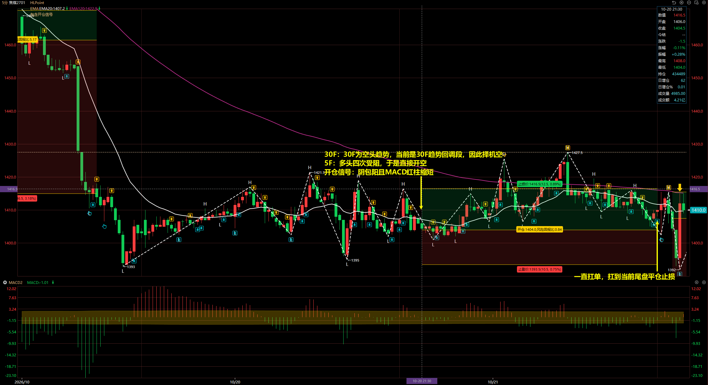
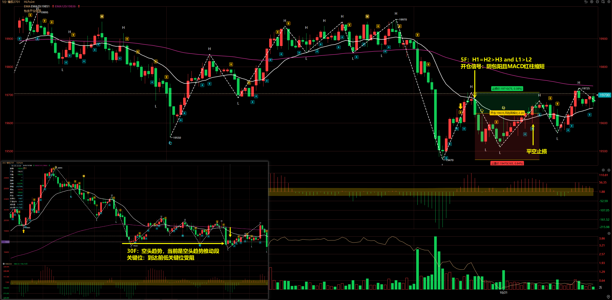
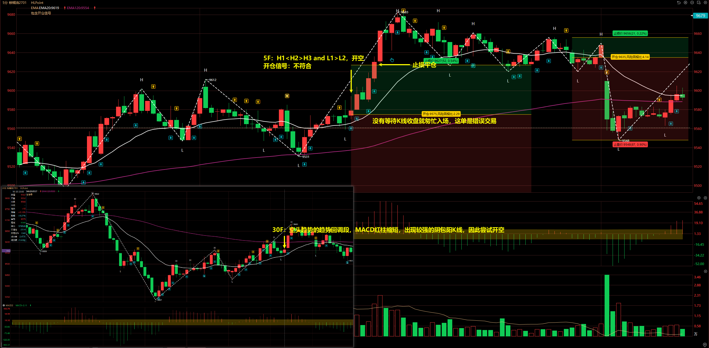
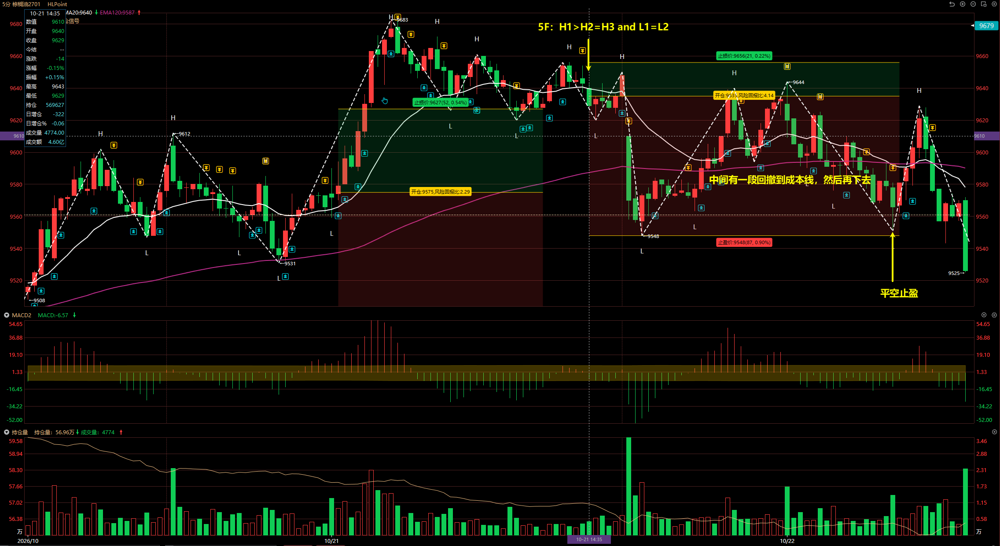
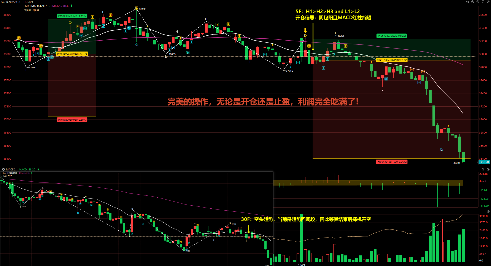
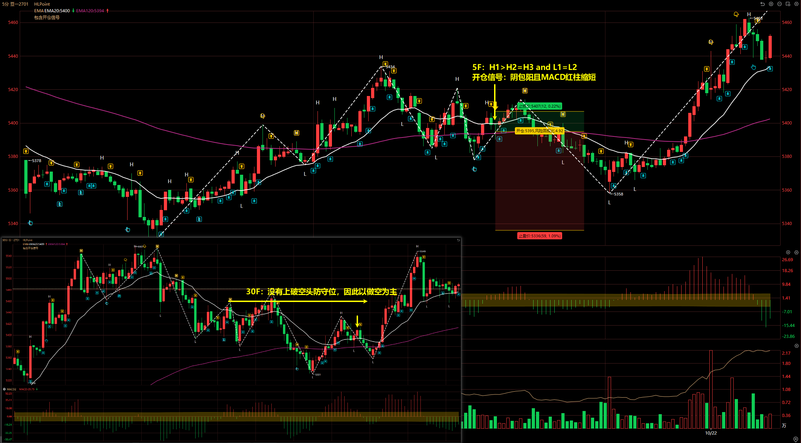

# 2026/10/21

## 焦煤 2701 <Badge type="danger" text="扛单" />

30F：30F 为空头趋势，当前是 30F 趋势回调段，因此择机空

5F：多头四次受阻于是直接开空

开仓信号：阴包阳且 MACD 红柱缩短

::: danger

一直扛单，抗到当天尾盘平仓止损离场。

:::

## 橡胶 2701

30F：空头趋势，当前是空头趋势推动段

关键位：到达前低关键位受阻

5F：H1 = H2 > H3 and L1 > L2

开仓信号：阴包阳且 MACD 红柱缩短

到达前低关键位附近受阻，就不该开仓的。

## 棕榈油 2701

30F：空头趋势的趋势回调段，MACD 红柱缩短，出现较强的阴包阳 K 线，因此尝试开空

5F：H1 < H2> H3 and L1 > L2，开空

开仓信号：不符合

::: danger

没有等待 K 线收盘就匆忙入场，这单是错误交易。

:::

棕榈油当天第二次开空：

5F：H1 > H2 = H3 and L1 = L2

## 多晶硅 2612

30F：空头趋势，当前是趋势回调段，因此择机开空

5F：H1 > H2 > H3 and L1 > L2

开仓信号：阴包阳且 MACD 红柱缩短

这单交易是完美操作！无论是开仓还是尾盘止盈，利润完全吃满！

## 豆一 2701

30F：没有上破空头防守位，因此以做空为主

5F：H1 > H2 = H3 and L1 = L2

开仓信号：阴包阳且 MACD 红柱缩短

