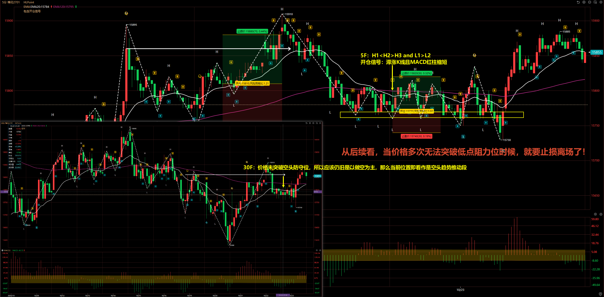
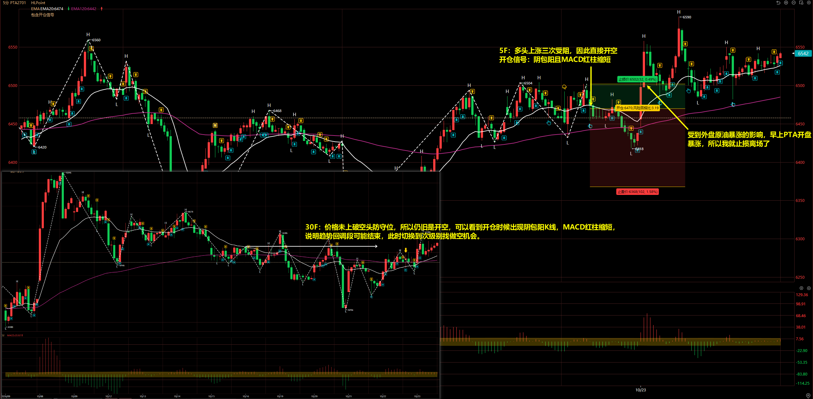
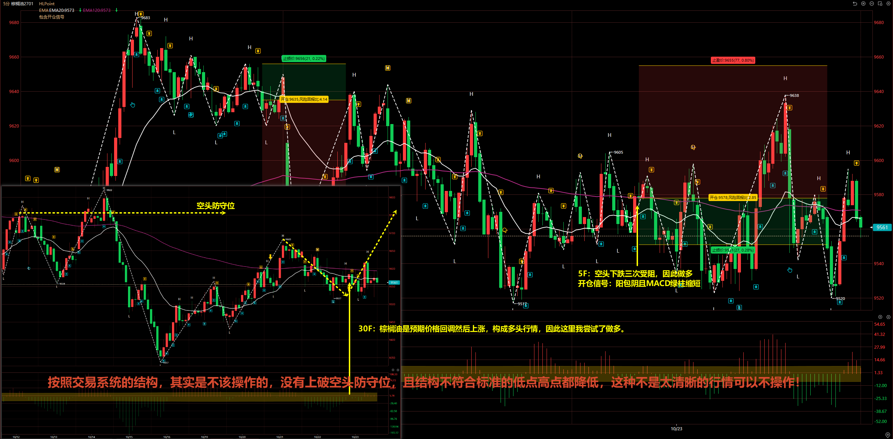
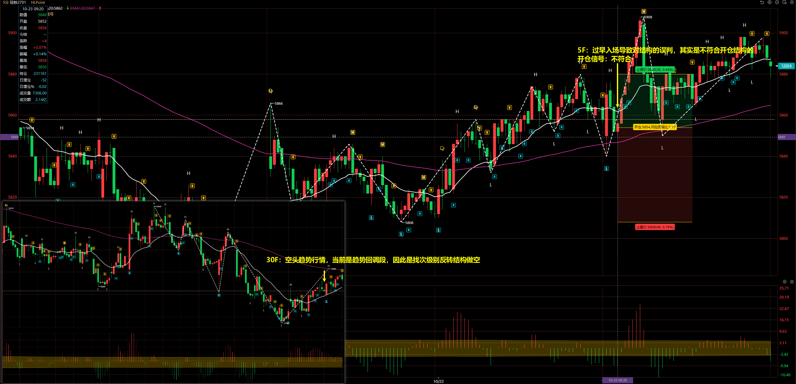

# 2026/10/23

## 棉花 2701

30F：价格未突破空头防守位，所以应该仍旧是以做空为主，那么当前位置即看作是空头趋势推动段。

5F：H1 < H2 > H3 and L1 > L2

开仓信号：滞涨 K 线且 MACD 红柱缩短

从后续看，**当价格多次无法突破低点阻力位时候，就要止损离场了**！

## PTA 2701

30F：价格未上破空头防守位，所以仍旧是开空，可以看到开仓时候出现阴包阳 K 线，MACD 红柱缩短，
说明趋势回调段可能结束，此时切换到次级别找做空机会。

5F：多头上涨三次受阻，因此直接开空

开仓信号：阴包阳且 MACD 红柱缩短

受到外盘原油暴涨的影响，早上 PTA 开盘暴涨，所以我就止损离场了。

::: danger

当出现较大幅度浮盈时候，可以把止损拉到成本线。

:::

## 棕榈油 2701

30F：棕榈油是预期价格回调然后上涨，构成多头行情，因此这里我尝试了做多。

5F：空头下跌三次受阻，因此做多

开仓信号：阳包阴且 MACD 绿柱缩短

最终不出意外价格下破结构低点，虽然扛单了一次价格上去了，但紧接着又下来了。

**按照交易系统的结构，其实是不该操作的，没有上破空头防守位，且结构不符合标准的低点高点都降低，这种不是太清晰的行情可以不操作！**

## 硅铁 2612

30F：空头趋势行情，当前是趋势回调段，因此是找次级别反转结构做空

5F：过早入场导致对结构的误判，其实是不符合开仓结构的

开仓信号：不符合

这单交易是错误交易，不应该操作的！

**开仓时候要注意大级别、操作级别、开仓信号同时符合才能操作，不能因为客观上没有机会而在主观上找机会。**

## 总结

今天做的不咋地，4 单交易都是亏损了，首先棕榈油多单和硅铁空单是不该做的。而今天市场整体是对之前空头趋势行情的回调，所以市场大部分品种都是上涨的，但按照我的交易系统，30F 空头趋势只做空，所以今天的行情应该说是不该怎么操作的。