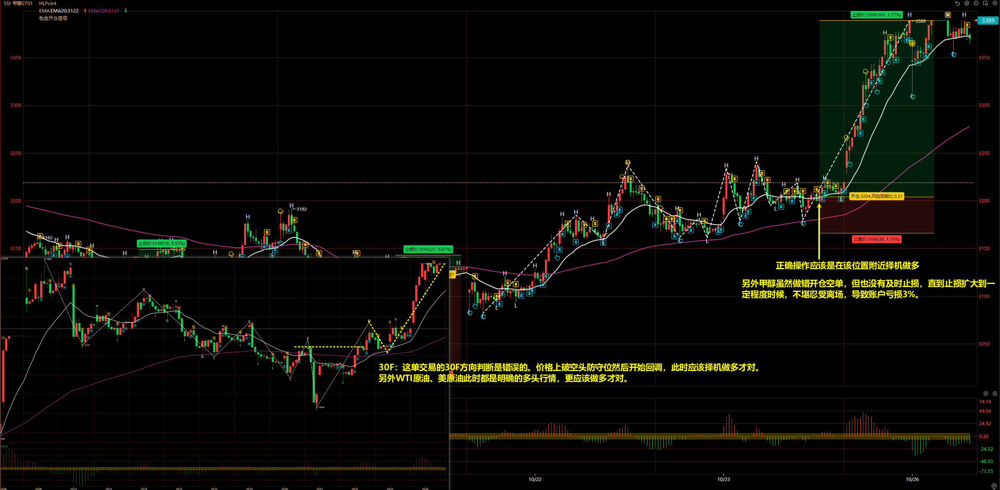
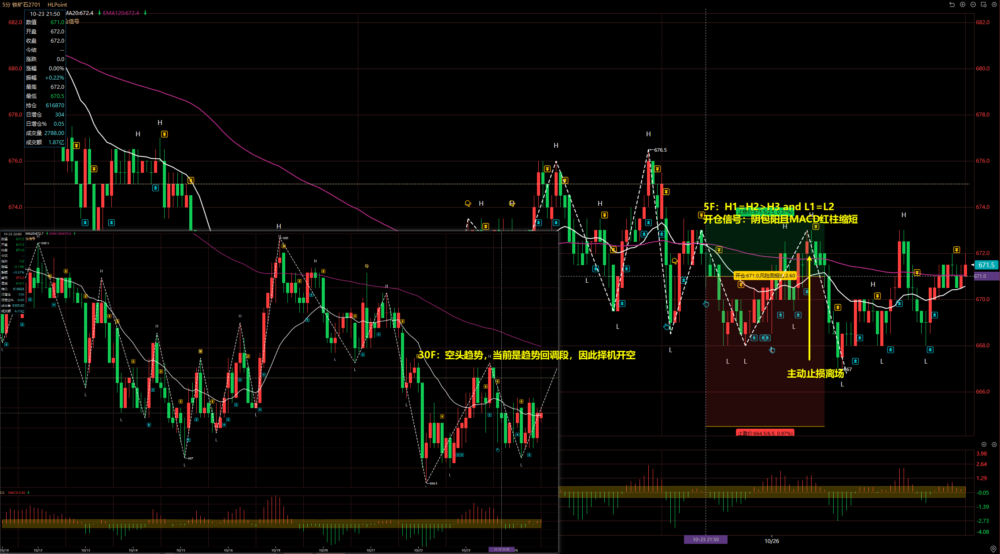
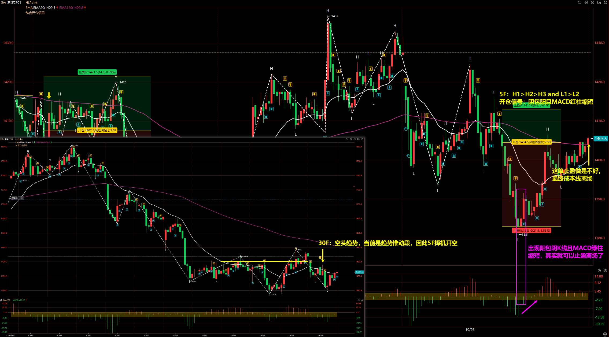
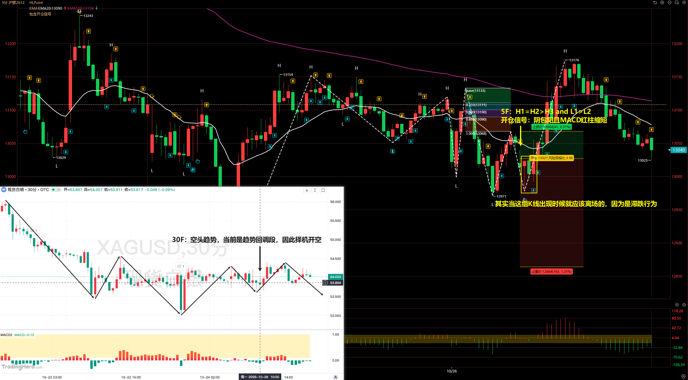
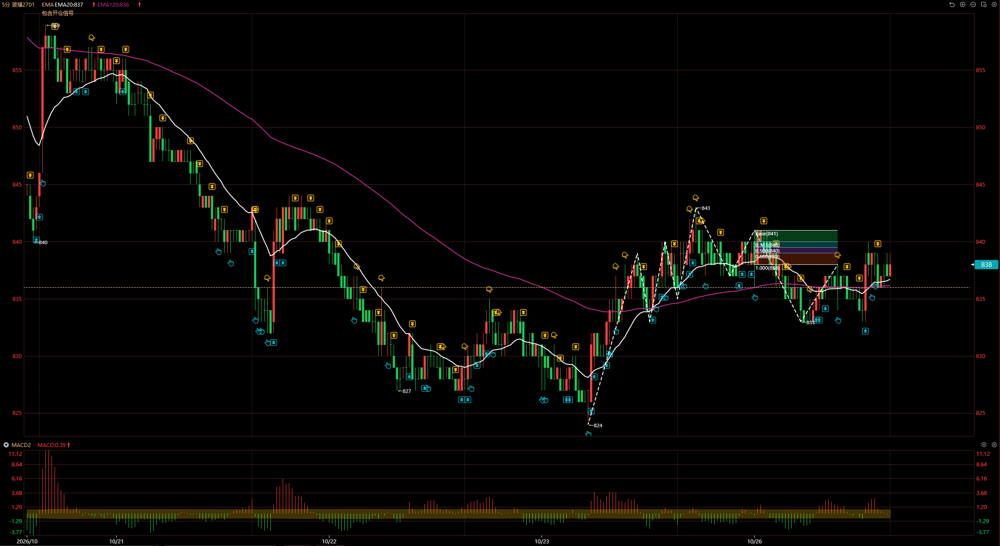
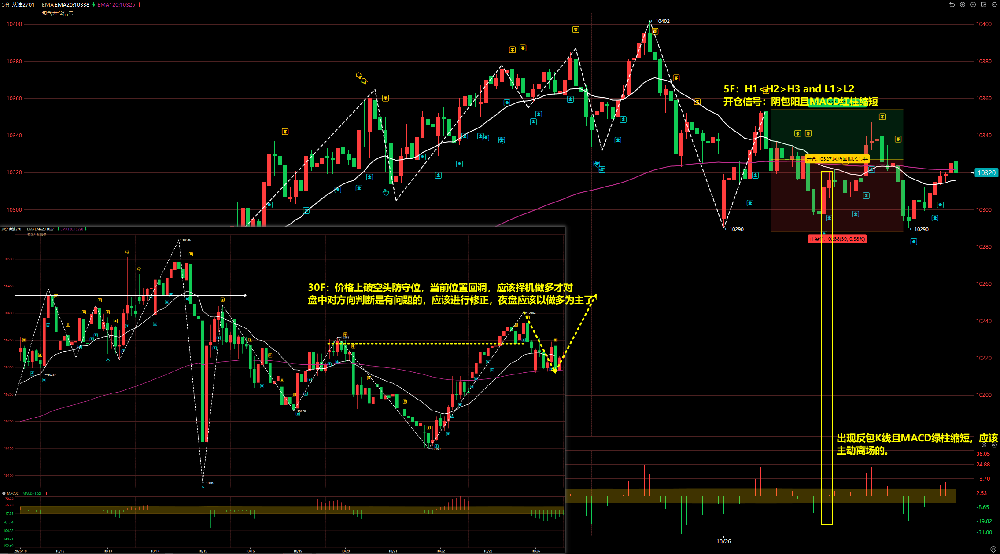
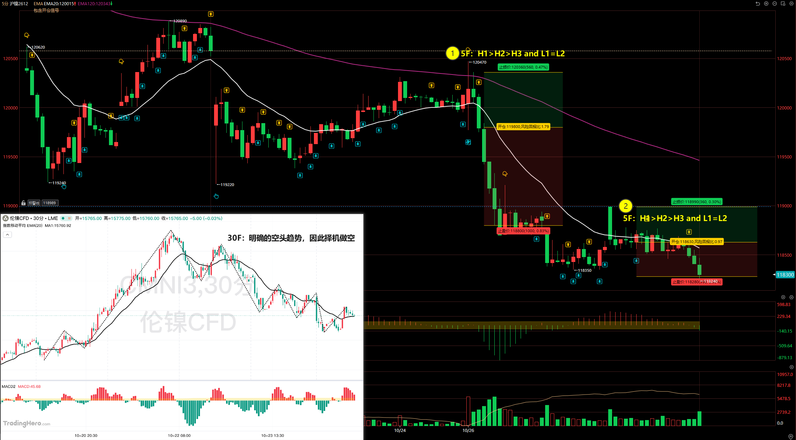

# 2026/10/26

## 甲醇 2701

30F：这单交易的 30F 方向判断是错误的。价格上破空头防守位然后开始回调，此时应该择机做多才对。

另外 WTI 原油、美原油此时都是明确的多头行情，更应该做多才对。

**甲醇虽然做错开仓空单，但也没有及时止损，直到止损扩大到一定程度时候，不堪忍受离场，导致账户亏损 3%**。

::: danger

操作化工系品种要参考原油走势！

:::

## 铁矿石 2701

30F：空头趋势，当前是趋势回调段，因此择机开空

5F：H1 = H2 > H3 and L1 = L2

开仓信号：阴包阳且 MACD 红柱缩短

## 焦煤 2701

30F：空头趋势，当前是趋势推动段，因此 5F 择机开空

5F：H1 > H2 > H3 and L1 > L2

开仓信号：阴包阳且 MACD 红柱缩短

这单止盈做的不好，最终是成本线离场。从事后看，**当出现阳包阴 K 线且 MACD 绿柱缩短，其实就可以止盈离场了**。

## 白银 2612

30F：空头趋势，当前是趋势回调段，因此择机开空

5F：H1 = H2 > H3 and L1 > L2

开仓信号：阴包阳且 MACD 红柱缩短

## 玻璃 2701

玻璃没啥好说的，30F 空头趋势，5F 出现 H1 > H2 > H3 and L1 > L2 结构，但可惜后续打止损离场。

## 菜油 2701

30F：价格上破空头防守位，当前位置回调，应该择机做多才对
盘中对方向判断是有问题的，应该进行修正，夜盘应该以做多为主了

5F：H1 < H2 > H3 and L1 > L2

开仓信号：阴包阳且 MACD 红柱缩短

::: danger

30F 方向判断有问题，应该择机做多才对！

:::

## 沪镍 2612

30F：明确的空头趋势，因此择机做空

5F：

- 第一次：H1 > H2 > H3 and L1 = L2
- 第二次：H1 > H2 > H3 and L1 > L2

