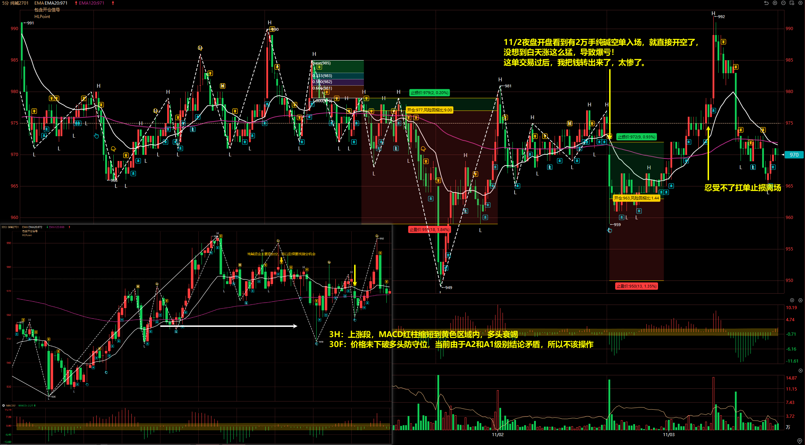
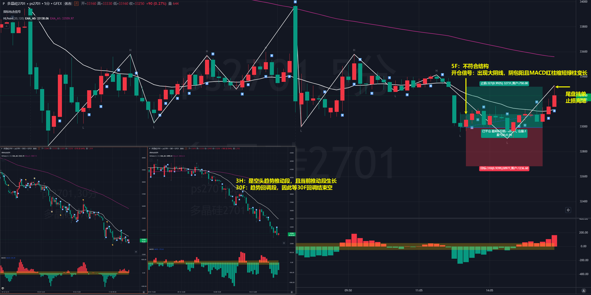

# 2026/11/03

## 纯碱 2701

3H：上涨段，MACD 红柱缩短到黄色区域内，多头衰竭

30F：价格未下破多头防守位，当前由于 A2 和 A1 级别结论矛盾，所以不该操作

11/2 夜盘开盘看到有 2 万手纯碱空单入场，就直接开空了，
没想到白天涨这么猛，导致爆亏！

这单交易过后，我把钱转出来了，太惨了。

## 多晶硅 2701

3H：是空头趋势推动段，且当前推动段生长

30F：趋势回调段，因此等 30F 回调结束空

5F：不符合结构

开仓信号：出现大阴线，阴包阳且 MACD 红柱缩短绿柱变长

