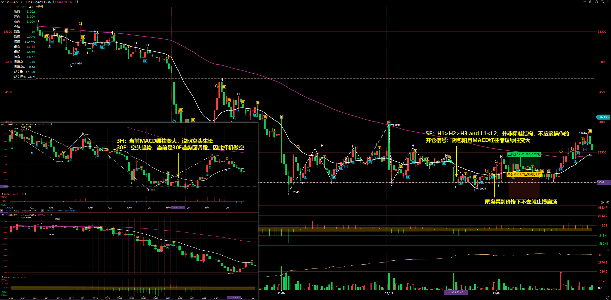
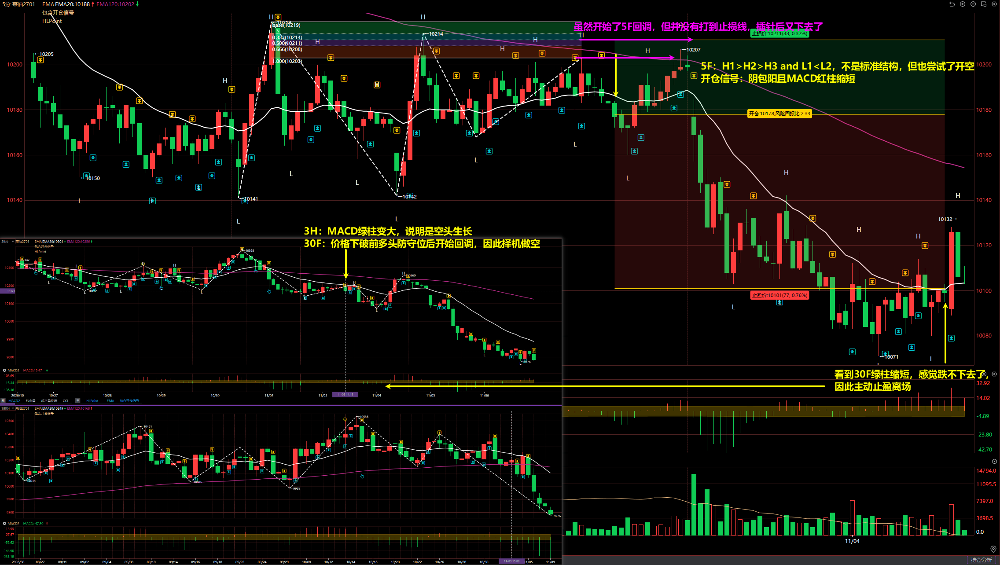
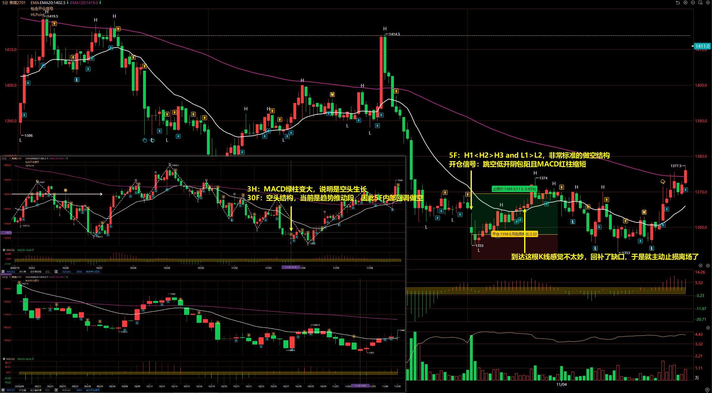
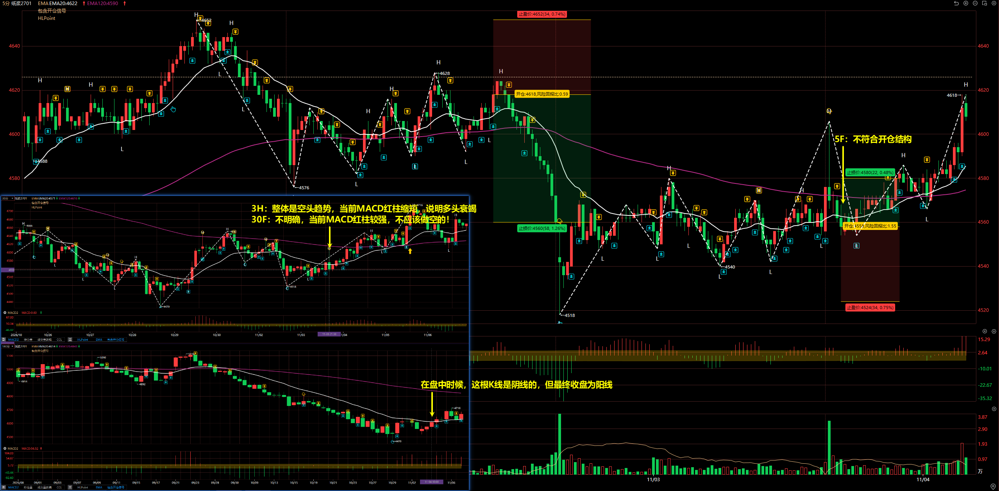
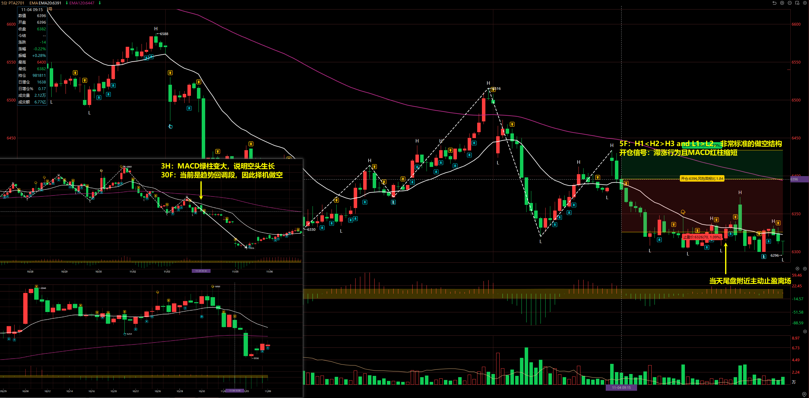
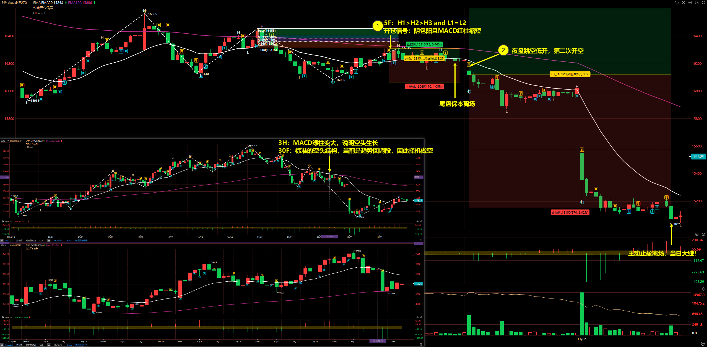

# 2026/11/05

## 多晶硅 2701

3H：当前 MACD 绿柱变大，说明空头生长

30F：空头趋势，当前是 30F 趋势回调段，因此择机做空

5F：H1 > H2 > H3 and L1 < L2，并非标准结构，不应该操作的

开仓信号：阴包阳且 MACD 红柱缩短绿柱变大

## 菜油 2701

3H：MACD 绿柱变大，说明是空头生长

30F：价格下破前多头防守位后开始回调，因此择机做空

5F：H1 > H2 > H3 and L1 < L2，不是标准结构，但也尝试了开空

开仓信号：阴包阳且 MACD 红柱缩短

离场：虽然开始了 5F 回调，但并没有打到止损线，插针后又下去了

## 焦煤 2701

3H：MACD 绿柱变大，说明是空头生长

30F：空头结构，当前是趋势推动段，因此 5F 内部回调做空

5F：H1 < H2 > H3 and L1 > L2，非常标准的做空结构

开仓信号：跳空低开阴包阳且 MACD 红柱缩短

## 纸浆 2701

3H：整体是空头趋势，当前 MACD 红柱缩短，说明多头衰竭

30F：不明确，当前 MACD 红柱较强，不应该做空的！

5F：不符合开仓结构

::: danger

纸浆当前位置做多做空都不好，从多头看，价格突破前空头防守位后觉得能构成新的 3H 上涨段，当然这个位置在实盘也是尝试了多单的，可惜直接打穿，变成了高低点都降低的结构，因此第二次尝试了空单。

不说之前的，就当前位置，30F 的 MACD 红柱其实还并没有明确连续变小就匆匆入场，应该再等等的。

:::

## PTA 2701

3H：MACD 绿柱变大，说明空头生长

30F：当前是趋势回调段，因此择机做空

5F：H1 < H2 > H3 and L1 > L2，非常标准的做空结构

开仓信号：滞涨行为且 MACD 红柱缩短

## 合成橡胶 2701

3H：MACD 绿柱变大，说明空头生长

30F：标准的空头结构，当前是趋势回调段，因此择机做空

5F：

- 第一次：H1 > H2 > H3 and L1 = L2
- 第二次：H1 > H2 > H3 and L1 = L2

开仓信号：阴包阳且 MACD 红柱缩短

