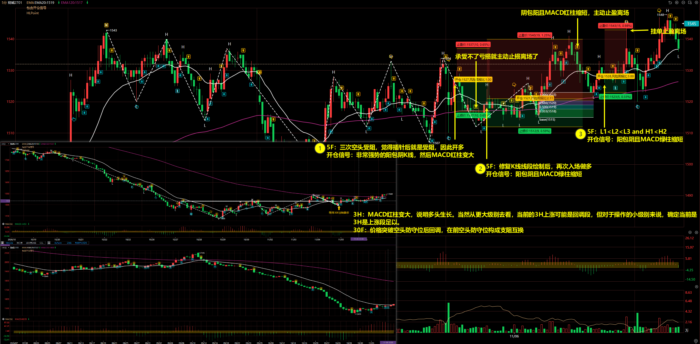
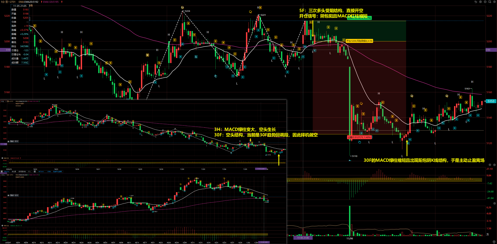
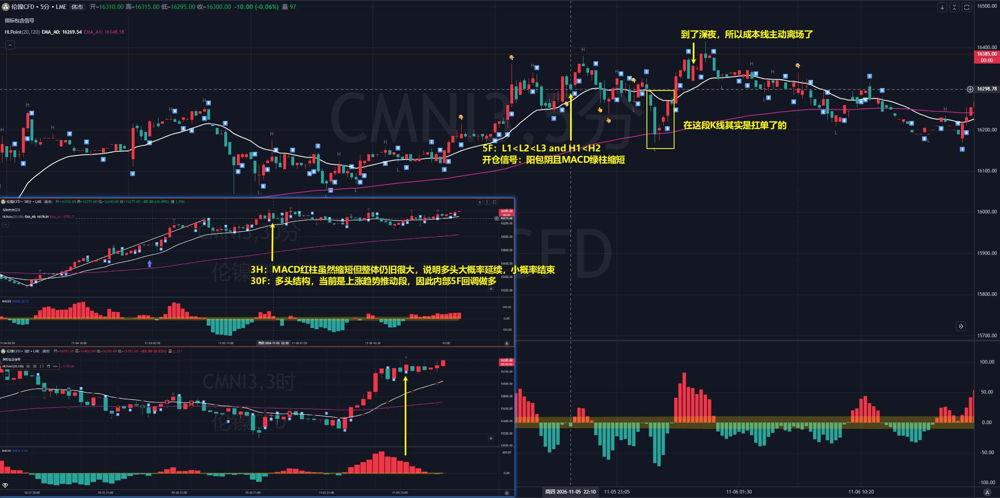
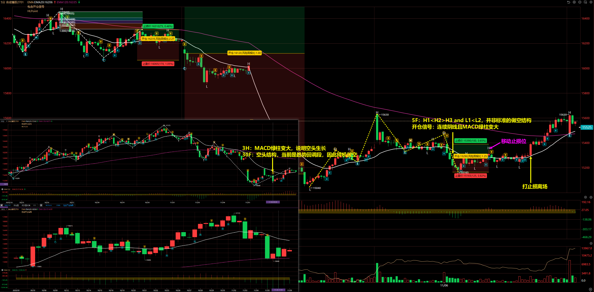
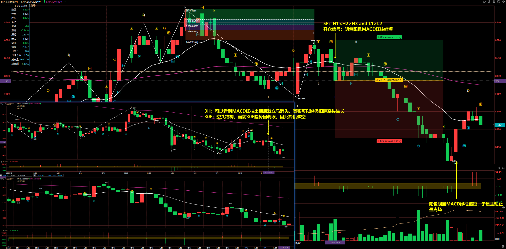

# 2026/11/05

## 烧碱 2701

3H：MACD 红柱变大，说明多头生长。当然从更大级别去看，当前的 3H 上涨可能是回调段，但对于操作的小级别来说，确定当前是 3H 是上涨段足以。

30F：价格突破空头防守位后回调，在前空头防守位构成支阻互换

5F：

- 第一次：三次空头受阻，觉得插针后就是受阻，因此开多
- 第二次：修复 K 线线段绘制后，再次入场做多
- 第三次：L1 < L2 < L3 and H1 < H2

开仓信号：非常强势的阳包阴 K 线，然后 MACD 红柱变大

## 豆一 2701

3H：MACD 绿柱变大，空头生长

30F：空头结构，当前是 30F 趋势回调段，因此择机做空

5F：三次多头受阻结构，直接开空

开仓信号：阴包阳且 MACD 红柱缩短

离场：30F 的 MACD 绿柱缩短且出现阳包阴 K 线结构，于是主动止盈离场

## 沪镍 2701

3H：MACD 红柱虽然缩短但整体仍旧很大，说明多头大概率延续，小概率结束 3

30F：多头结构，当前是上涨趋势推动段，因此内部 5F 回调做多

5F：L1 < L2 < L3 and H1 < H2

开仓信号：阳包阴且 MACD 绿柱缩短

::: danger

这单交易其实是有扛单的，虽然最终扛回来了，但要记住扛单不是啥好事儿！

:::

## 合成橡胶 2701

3H：MACD 绿柱变大，说明空头生长

30F：空头结构，当前是趋势回调段，因此择机做空

5F：H1 < H2 > H3 and L1 < L2，并非标准的做空结构

开仓信号：连续阴线且 MACD 绿柱变大

::: tip

做限价单止损位置终于起作用了！这单交易大阳线成交止损离场，如果没有成交亏损会不断扩大。

:::

## 工业硅 2701

3H：可以看到 MACD 红柱出现后就立马消失，其实可以说仍旧是空头生长

30F：空头结构，当前 30F 趋势回调段，因此择机做空

5F：H1 < H2 > H3 and L1 > L2

开仓信号：阴包阳且 MACD 红柱缩短

离场：阳包阴且 MACD 绿柱缩短，于是主动止盈离场

