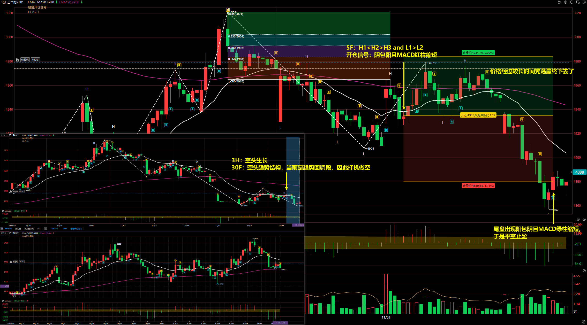
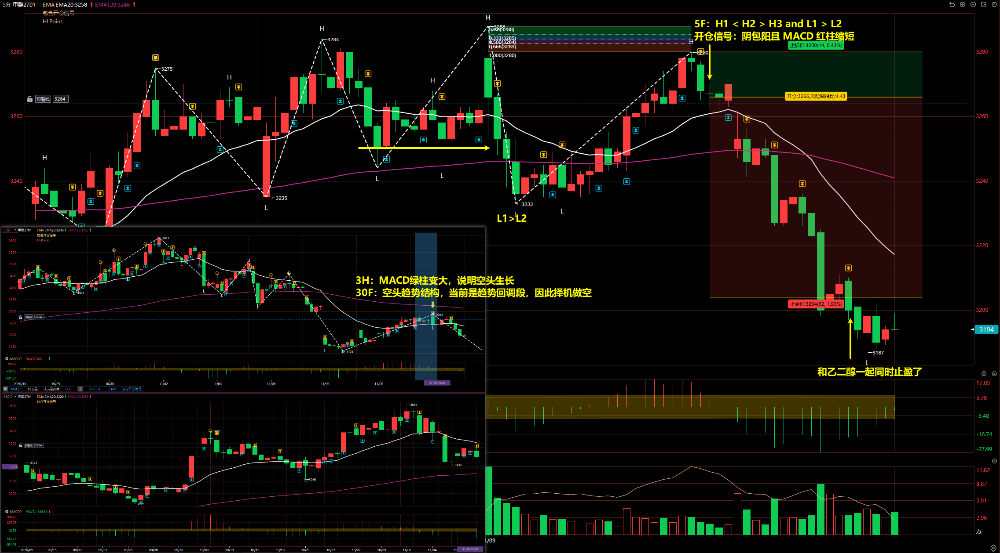
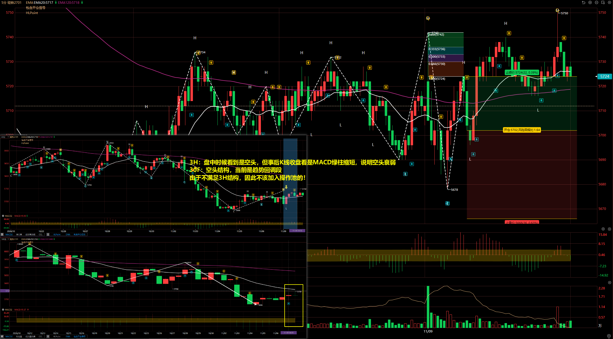
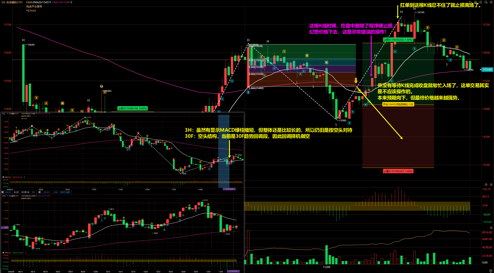

# 2026/11/09

## 乙二醇 2701

3H：MACD 绿柱变大，说明空头生长

30F：空头趋势结构，当前是趋势回调段，因此择机做空

5F：H1 < H2 > H3 and L1 > L2

开仓信号：阴包阳且 MACD 红柱缩短

离场：尾盘出现阳包阴且 MACD 绿柱缩短，于是平空止盈

## 甲醇 2701

3H：MACD 绿柱变大，说明空头生长

30F：空头趋势结构，当前是趋势回调段，因此择机做空

5F：H1 < H2 > H3 and L1 > L2

开仓信号：阴包阳且 MACD 红柱缩短

## 硅铁 2701

3H：盘中时候看到是空头，但事后 K 线收盘看是 MACD 绿柱缩短，说明空头衰弱

30F：空头结构，当前是趋势回调段

::: danger

虽然 30F 符合空头结构，但 3H 显示空头衰弱，所以不该加入操作池的！从结果看，最终这个 30F 回调空的预期没有实现。

:::

## 合成橡胶 2701

3H：虽然有显示 MACD 绿柱缩短，但整体还是比较长的，所以仍旧是按空头对待

30F：空头结构，当前是 30F 趋势回调段，因此回调择机做空

开仓：并没有等待 K 线完成收盘就匆忙入场了，这单交易其实是不应该操作的。

本来预期向下，但最终价格越来越强势。

离场：扛单止损离场

::: danger

在盘中删除了程序硬止损，
幻想价格下去，这是非常错误的操作！

:::

