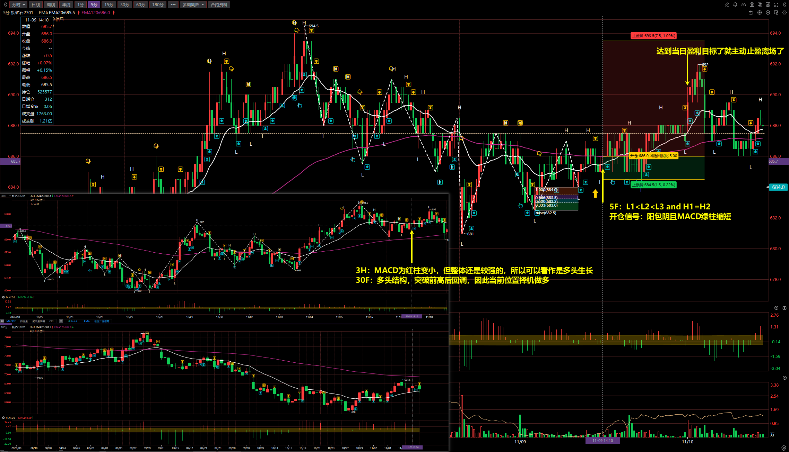
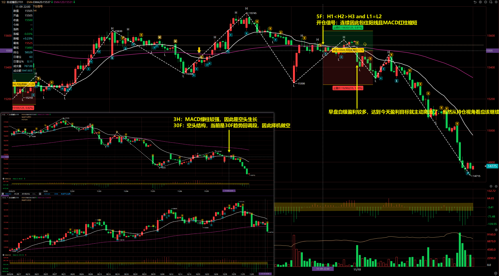
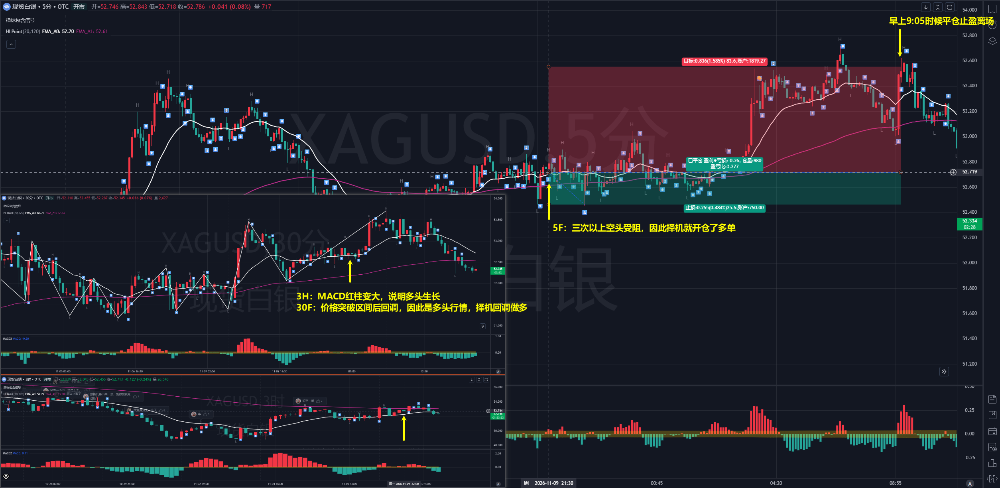

## 2026/11/10

## 铁矿石 2701

3H：MACD 为红柱变小，但整体还是较强的，所以可以看作是多头生长

30F：多头结构，突破前高后回调，因此当前位置择机做多

5F：L1 < L2 < L3 and H1 = H2

开仓信号：阳包阴且 MACD 绿柱缩短

## 合成橡胶 2701

3H：MACD 绿柱较强，因此是空头生长

30F：空头结构，当前是 30F 趋势回调段，因此择机做空

5F：H1 < H2 > H3 and L1 = L2

开仓信号：连续因此包住阳线且 MACD 红柱缩短

离场：早盘白银盈利较多，达到今天盈利目标就主动离场了，当然从持仓视角看应该继续拿着的！

## 沪银 2702

3H：MACD 红柱变大，说明多头生长

30F：价格突破区间后回调，因此是多头行情，择机回调做多

5F：三次以上空头受阻，因此择机就开仓了多单

