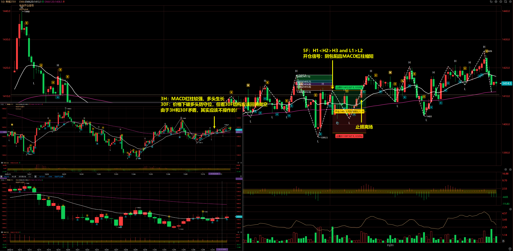
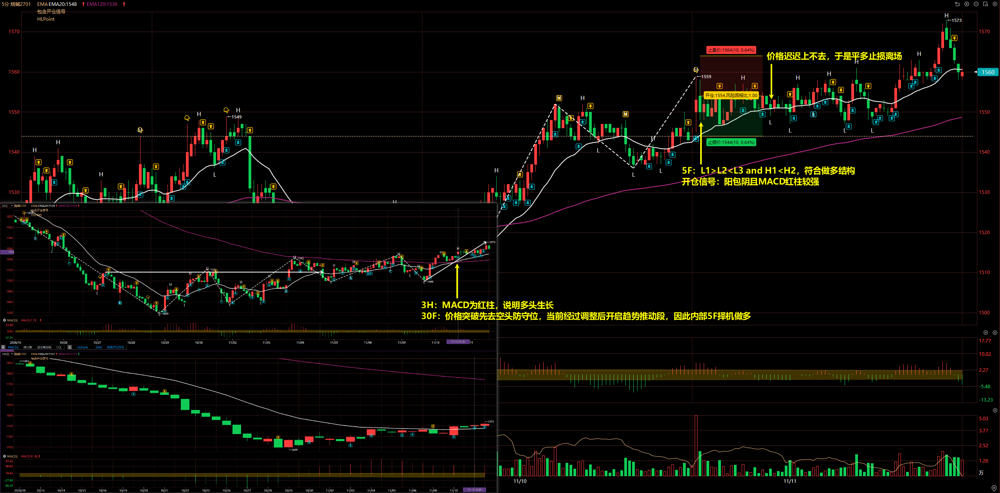
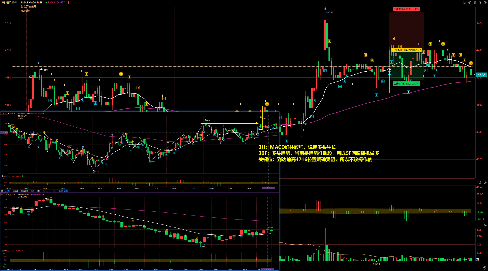
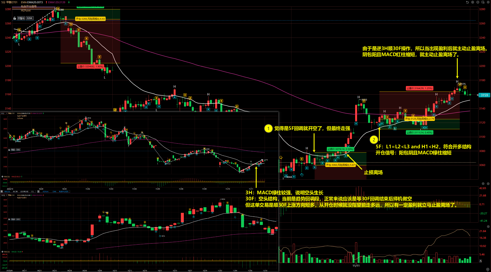
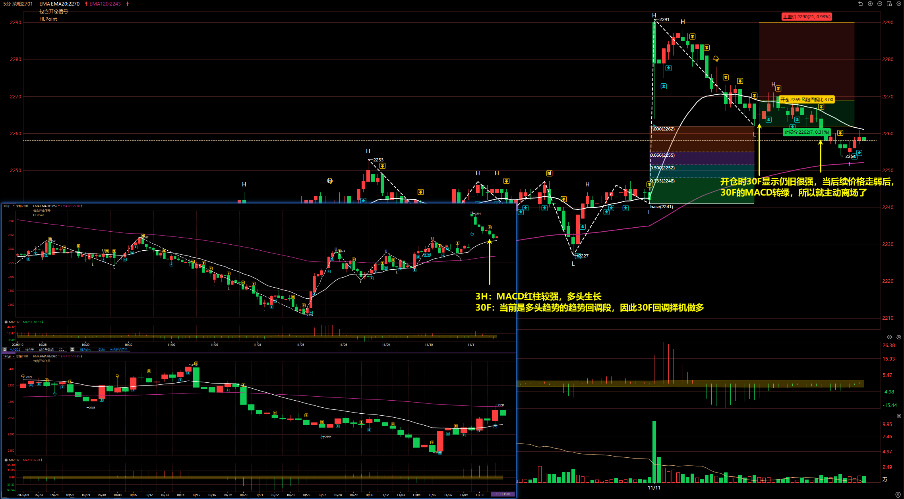
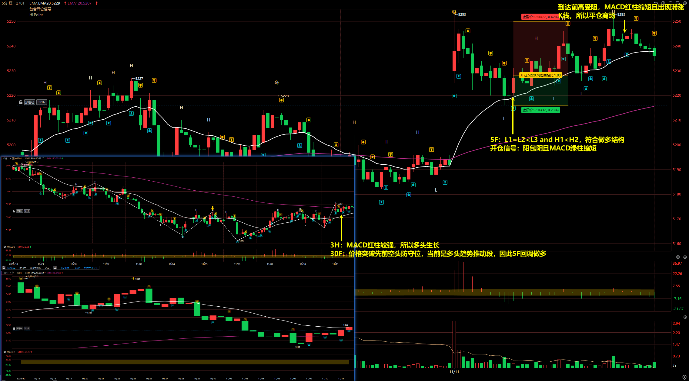

# 2026/11/11

## 焦煤 2701

3H：MACD 红柱较强，多头生长

30F：价格下破多头防守位，但看 30F 结构应该回调做空。由于 3H 和 30F 矛盾，其实应该不操作的！

5F：H1 < H2 > H3 and L1 > L2，符合做空结构

开仓信号：阴包阳且 MACD 红柱缩短

## 烧碱 2701

3H：MACD 为红柱，说明多头生长

30F：价格突破先去空头防守位，当前经过调整后开启趋势推动段，因此内部 5F 择机做多

5F：L1 > L2 < L3 and H1 < H2，符合做多结构

开仓信号：阳包阴且 MACD 红柱较强

离场：价格迟迟上不去，于是平多止损离场

## 纸浆 2701

3H：MACD 红柱较强，说明多头生长

30F：多头趋势，当前是趋势推动段，所以 5F 回调择机做多

关键位：到达前高 4716 位置明确受阻，所以不该操作的

::: danger

注意 30F 到达关键位可能受阻而反向！

:::

## 甲醇 2701

3H：MACD 绿柱较强，说明空头生长

30F：空头结构，当前是趋势回调段，正常来说应该是等 30F 回调结束后择机做空。但这单交易是顺 30F 上涨方向短多，从开仓时候就没指望能走多远，所以有一定盈利就立马止盈离场了。

5F：

- 第一次：觉得是 5F 回调就开空了，但最终走强
- 第二次：L1 = L2 < L3 and H1 < H2，符合开多结构

离场：

- 第一次：止损离场
- 第二次：由于是逆 3H 顺 30F 操作，所以当出现盈利后就主动止盈离场。
阴包阳且 MACD 红柱缩短，就主动止盈离场了。

## 菜粕 2701

3H：MACD 红柱较强，多头生长

30F：当前是多头趋势的趋势回调段，因此 30F 回调择机做多

开仓时 30F 显示仍旧很强，当后续价格走弱后，30F 的 MACD 转绿，所以就主动离场了。

## 豆一 2701

3H：MACD 红柱较强，所以多头生长

30F：价格突破先前空头防守位，当前是多头趋势推动段，因此 5F 回调做多

5F：L1 = L2 < L3 and H1 < H2，符合做多结构

开仓信号：阳包阴且 MACD 绿柱缩短

离场：到达前高受阻，MACD 红柱缩短且出现滞涨 K 线，所以平仓离场。

