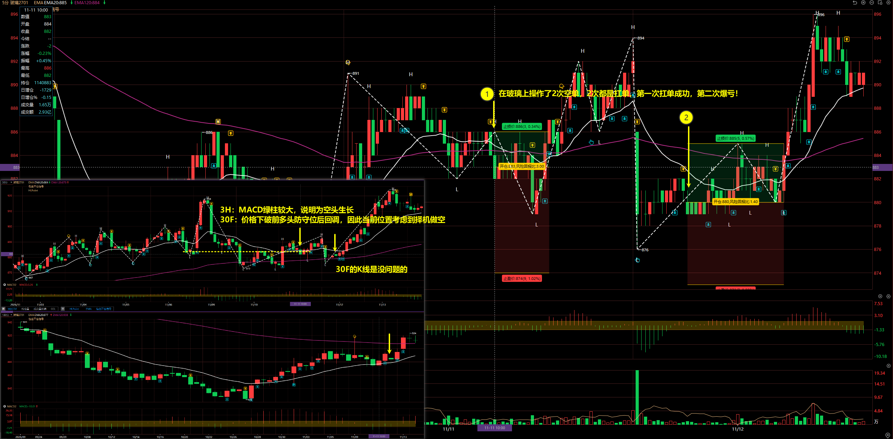
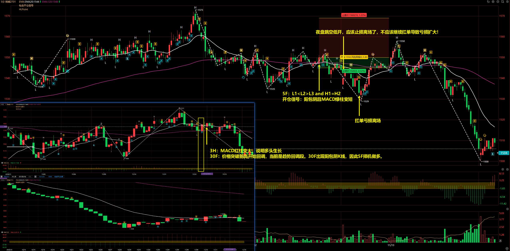
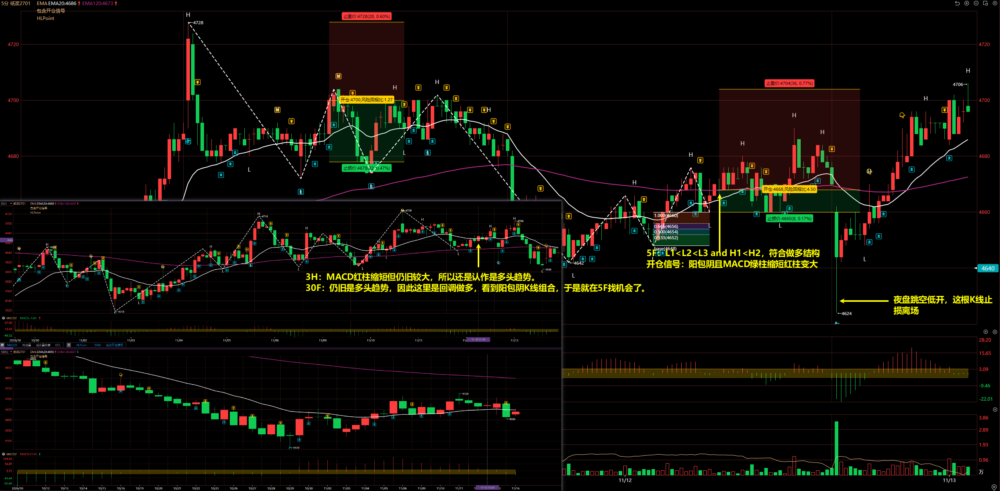
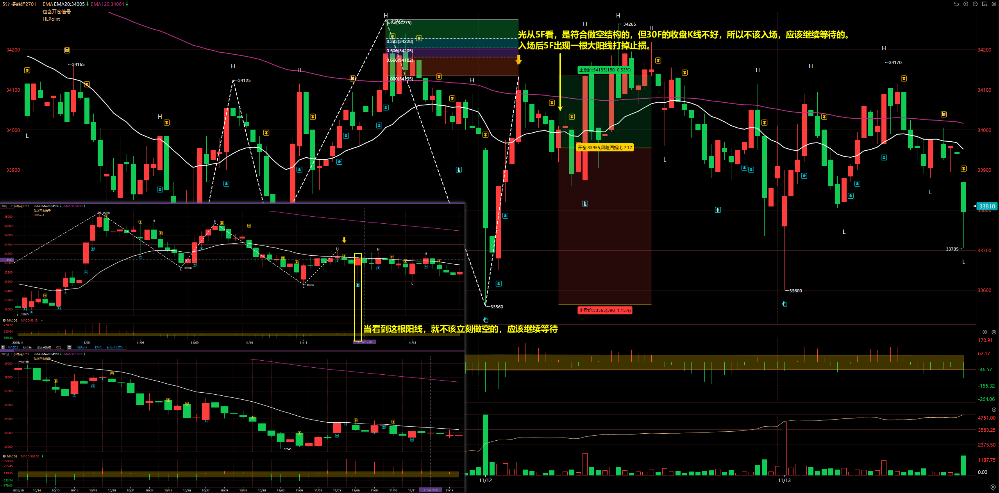
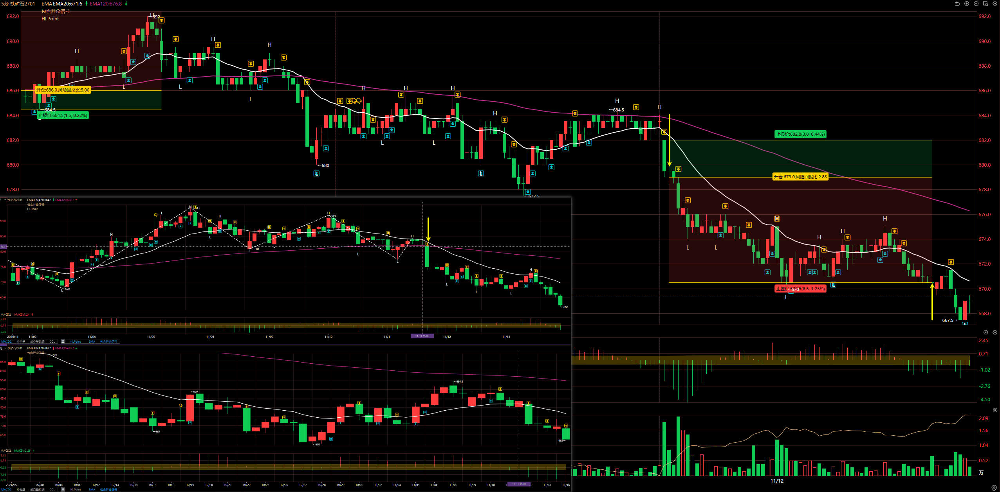

# 2026/11/12

## 玻璃 2701

3H：MACD 绿柱较大，说明为空头生长

30F：价格下破前多头防守位后回调，因此当前位置考虑到择机做空

在玻璃上操作了 2 次空单，2 次都是扛单，第一次扛单成功，第二次爆亏！

## 烧碱 2701

3H：MACD 红柱变大，说明多头生长

30F：价格突破前高开始回调，当前是趋势回调段。30F 出现阳包阴 K 线，因此 5F 择机做多。

5F：L1 < L2 > L3 and H1 = H2

开仓信号：阳包阴且 MACD 绿柱变短

夜盘跳空低开，应该止损离场了，不应该继续扛单导致亏损扩大！

## 纸浆 2701

3H：MACD 红柱缩短但仍旧较大，所以还是认作是多头趋势。

30F：仍旧是多头趋势，因此这里是回调做多，看到阳包阴 K 线组合，于是就在 5F 找机会了。

5F：L1 < L2 < L3 and H1 < H2，符合做多结构

开仓信号：阳包阴且 MACD 绿柱缩短红柱变大

## 多晶硅 2701

::: tip

做多需要在 30F 看到阳包阴 K 线才能进入 5F 找机会操作，做空需要在 30F 看到阴包阳 K 线才能进入 5F 找机会操作。

:::

## 铁矿石 2701

