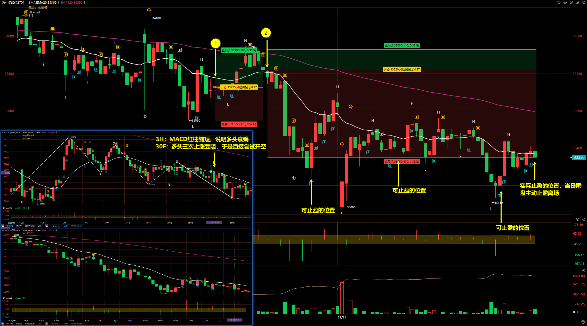
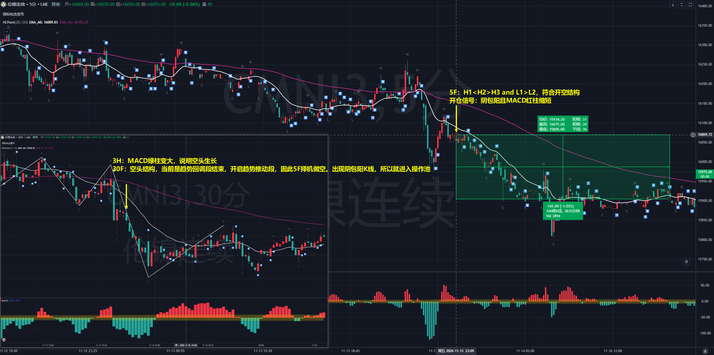

# 2026/11/17

## 多晶硅 2701

3H：MACD 红柱缩短，说明多头衰竭

30F：多头三次上涨受阻，于是直接尝试开空

当 30F 出现阴包阳 K 线后，在 5F 择机入场，尝试了 2 次，第二次成功。

## 沪镍 2701

3H：MACD 绿柱变大，说明空头生长

30F：空头结构，当前是趋势回调段结束，开启趋势推动段，因此 5F 择机做空。出现阴包阳 K 线，所以就进入操作池。

5F：H1 < H2 > H3 and L1 > L2，符合开空结构

开仓信号：阴包阳且 MACD 红柱缩短

