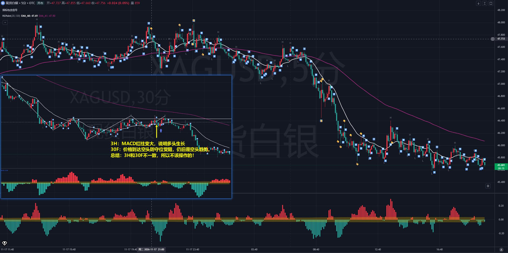
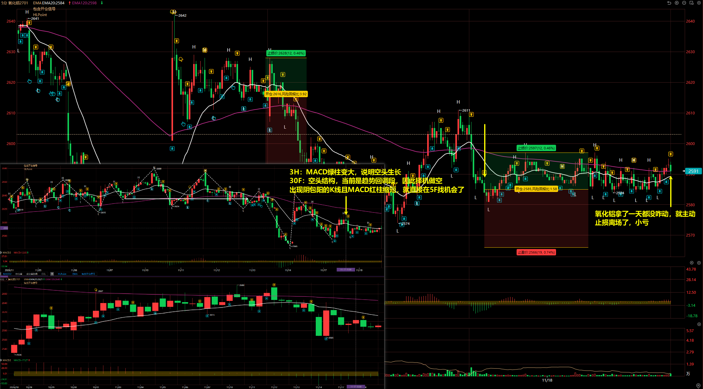
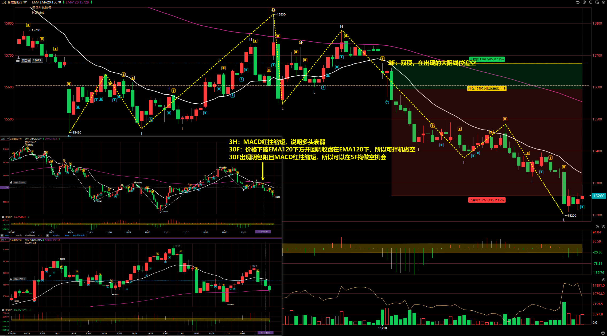
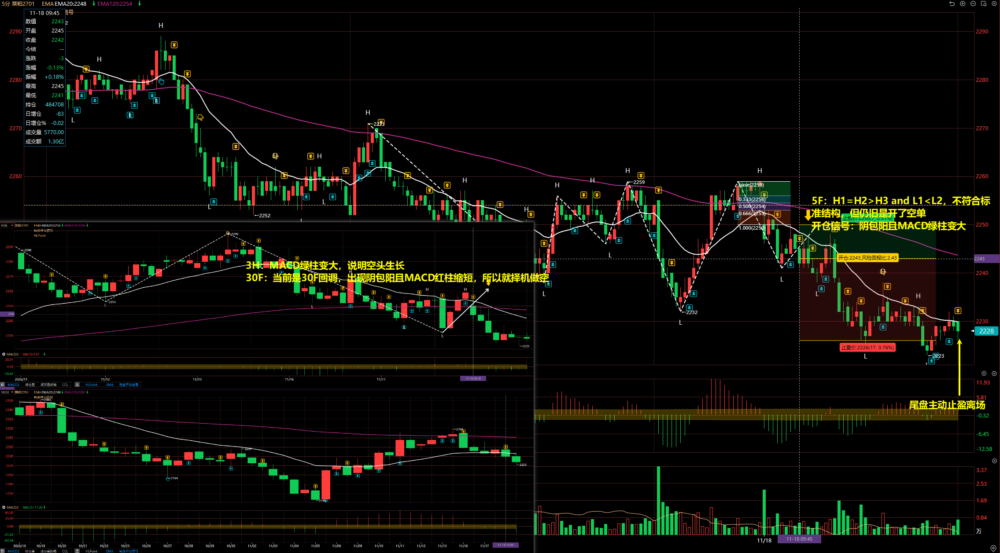
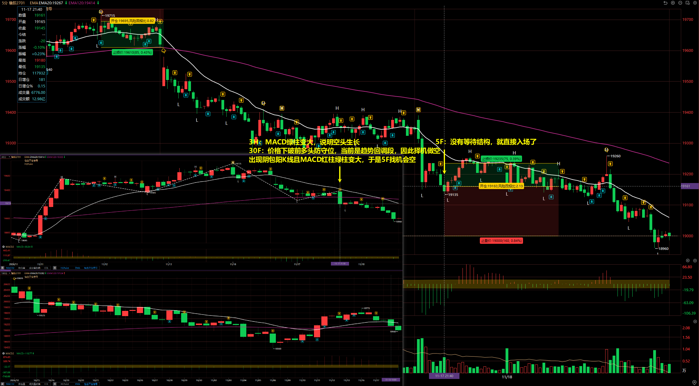

# 2026/11/18

## 沪银 2702 <Badge type="danger" text="扛单" />

3H：MACD 红柱变大，说明多头生长

30F：价格到达空头防守位受阻，仍旧是空头趋势。

总结：3H 和 30F 不一致，所以不该操作的！

## 氧化铝 2701

3H：MACD 绿柱变大，说明空头生长

30F：空头结构，当前是趋势回调段，因此择机做空

出现阴包阳的 K 线且 MACD 红柱缩短，就直接在 5F 找机会了

离场：氧化铝拿了一天都没咋动，就主动止损离场了，小亏

## 合成橡胶 2701

3H：MACD 红柱缩短，说明多头衰弱

30F：价格下破 EMA120 下方并回调收盘在 EMA120 下，所以可择机做空

30F 出现阴包阳且 MACD 红柱缩短，所以可以在 5F 找做空机会

5F：双顶，在出现的大阴线位追空

## 菜粕 2701

3H：MACD 绿柱变大，说明空头生长

30F：当前是 30F 回调，出现阴包阳且 MACD 红柱缩短，所以就择机做空

5F：H1 = H2 > H3 and L1 < L2，不符合标准结构，但仍旧是开了空单

开仓信号：阴包阳且 MACD 绿柱变大

## 橡胶 2701

3H：MACD 绿柱变大，说明空头生长

30F：价格下破前多头防守位，当前是趋势回调段，因此择机做空
出现阴包阳 K 线且 MACD 红柱绿柱变大，于是 5F 找机会空

5F：没有等待结构，就直接入场了

从后续看，橡胶价格还是下去了，但是我提前离场了。

