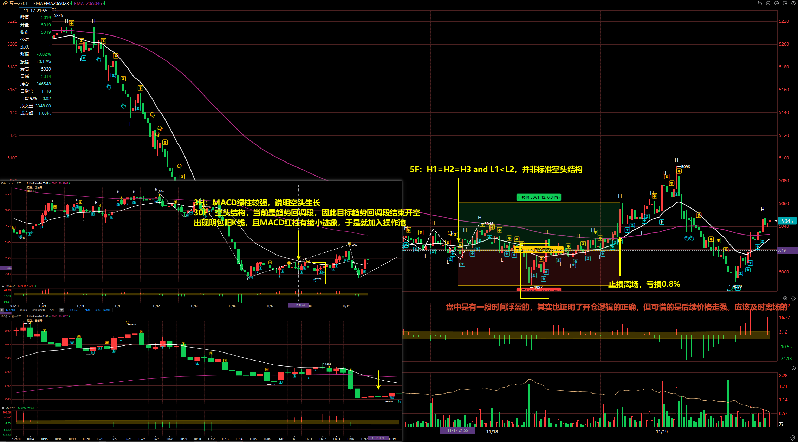
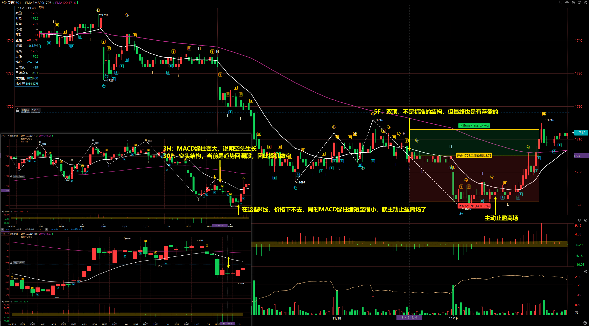
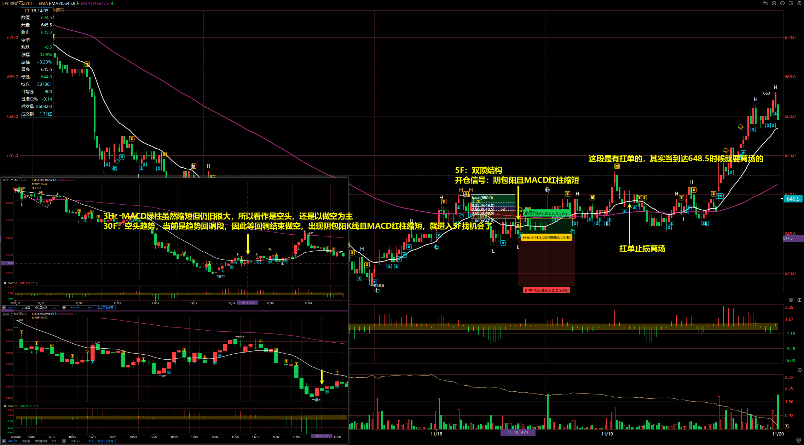
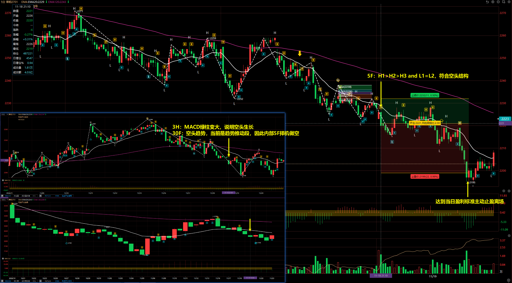
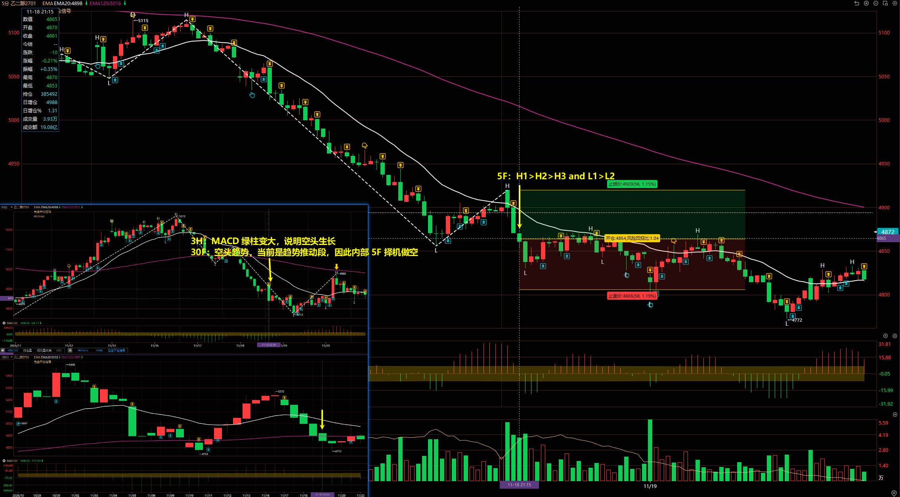
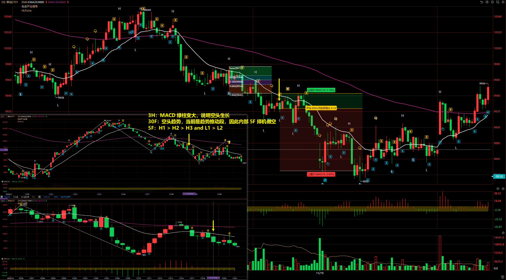
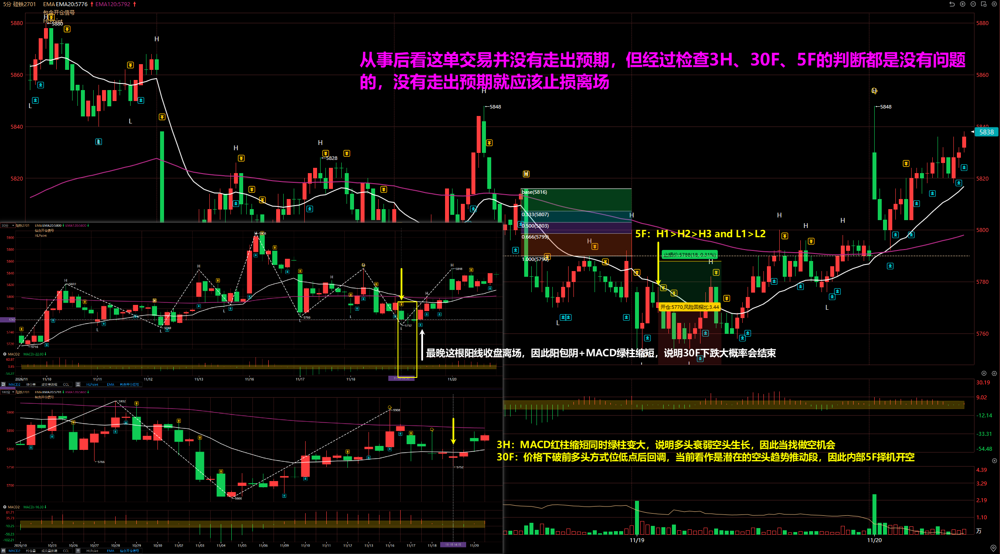
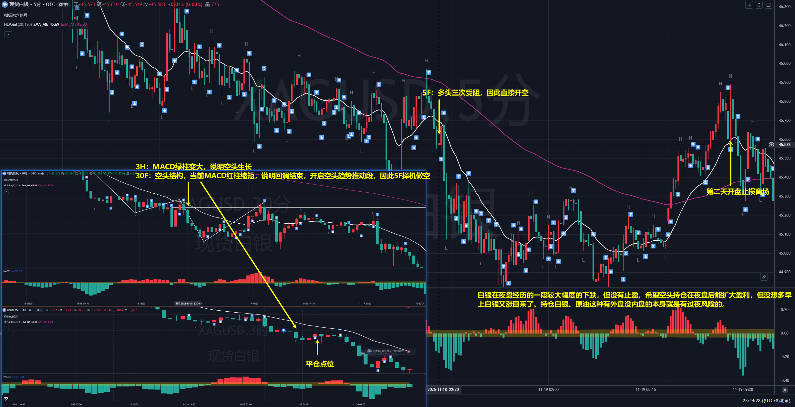

# 2026/11/19

## 豆一 2701

3H：MACD 绿柱较强，说明空头生长

30F：空头结构，当前是趋势回调段，因此目标趋势回调段结束开空
出现阴包阳 K 线，且 MACD 红柱有缩小迹象，于是就加入操作池

5F：H1 = H2 = H3 and L1 < L2，并非标准空头结构

::: tip

盘中是有一段时间浮盈的，其实也证明了开仓逻辑的正确，但可惜的是后续价格走强，应该及时离场的。

:::

## 尿素 2701

3H：MACD 绿柱变大，说明空头生长

30F：空头结构，当前是趋势回调段，因此择机做空

5F：双顶，不是标准的结构，但最终也是有浮盈的

## 铁矿石 2701

3H：MACD 绿柱虽然缩短但仍旧很大，所以看作是空头，还是以做空为主

30F：空头趋势，当前是趋势回调段，因此等回调结束做空。出现阴包阳 K 线且 MACD 红柱缩短，就进入 5F 找机会了

5F：觉得是双顶结构，但后续显示双顶是失效的。

开仓信号：阴包阳且 MACD 红柱缩短

::: danger

这段是有扛单的，其实当到达 648.5 时候就要离场的。

:::

## 菜粕 2701

3H：MACD 绿柱变大，说明空头生长

30F：空头趋势，当前是趋势推动段，因此内部 5F 择机做空

5F：H1 > H2 > H3 and L1 = L2，符合空头结构

## 乙二醇 2701

3H：MACD 绿柱变大，说明空头生长

30F：空头趋势，当前是趋势推动段，因此内部 5F 择机做空

5F：H1 > H2 > H3 and L1 > L2

## 菜油 2701

3H：MACD 绿柱变大，说明空头生长

30F：空头趋势，当前是趋势推动段，因此内部 5F 择机做空

5F：H1 > H2 > H3 and L1 > L2

## 硅铁 2701

3H：MACD 红柱缩短同时绿柱变大，说明多头衰弱空头生长，因此当找做空机会

30F：价格下破前多头方式位低点后回调，当前看作是潜在的空头趋势推动段，因此内部 5F 择机开空

5F：H1 > H2 > H3 and L1 > L2

::: tip

从事后看这单交易并没有走出预期，但经过检查 3H、30F、5F 的判断都是没有问题的，没有走出预期就应该止损离场。

:::

::: danger

有时候入场没问题，但后续行情不及预期，也是要主动离场的。

:::

## 沪银 2702

3H：MACD 绿柱变大，说明空头生长

30F：空头结构，当前 MACD 红柱缩短，说明回调结束，开启空头趋势推动段，因此 5F 择机做空

5F：多头三次受阻，因此直接开空

白银在夜盘经历的一段较大幅度的下跌，但没有止盈，希望空头持仓在夜盘后能扩大盈利，但没想多早上白银又涨回来了。

::: danger

持仓白银、原油这种有外盘没内盘的本身就是有过夜风险的。

:::

