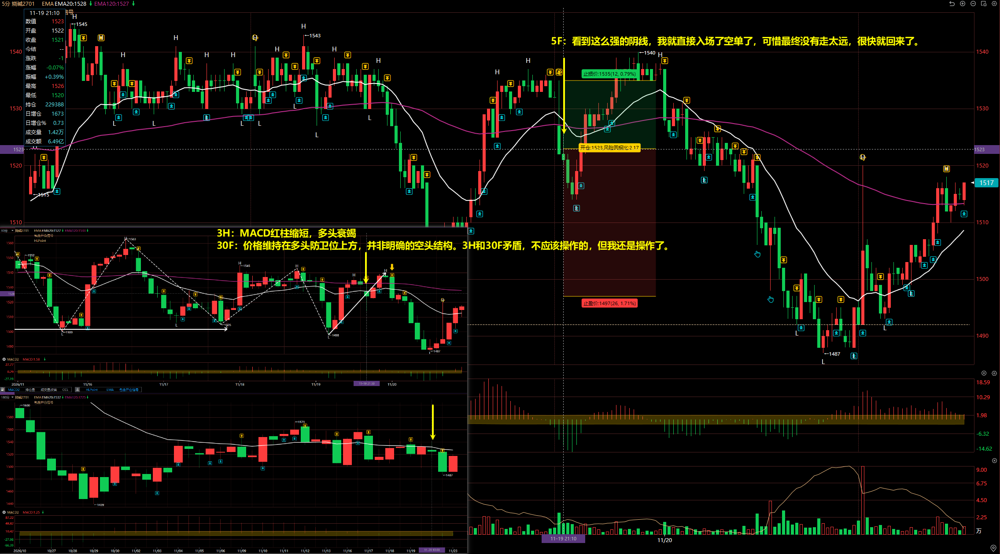
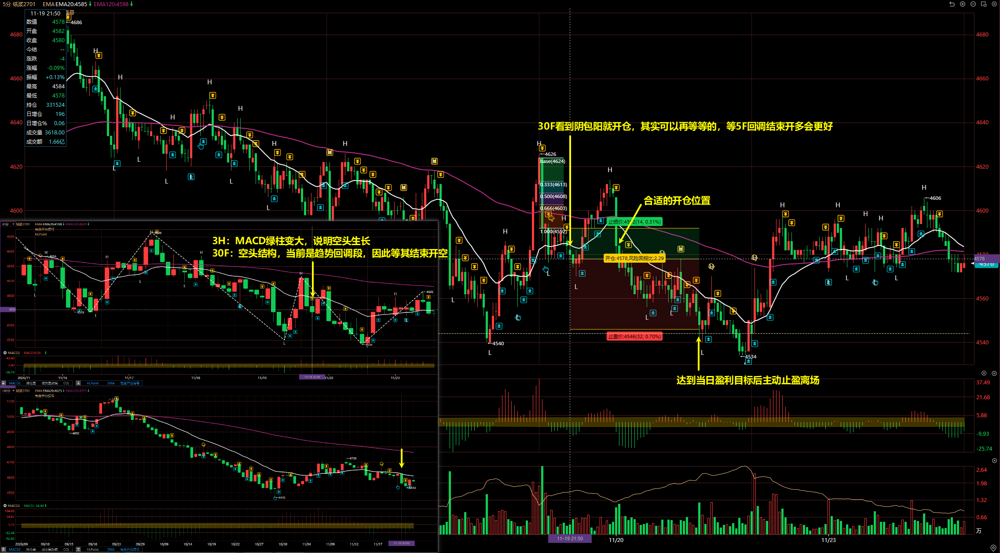
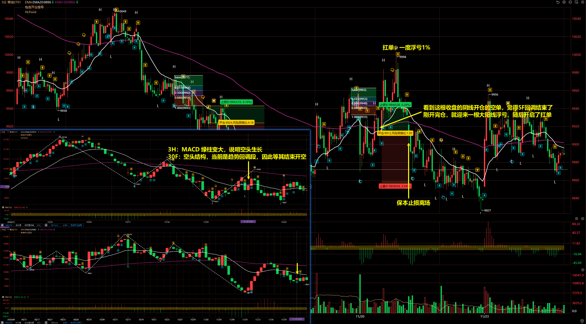
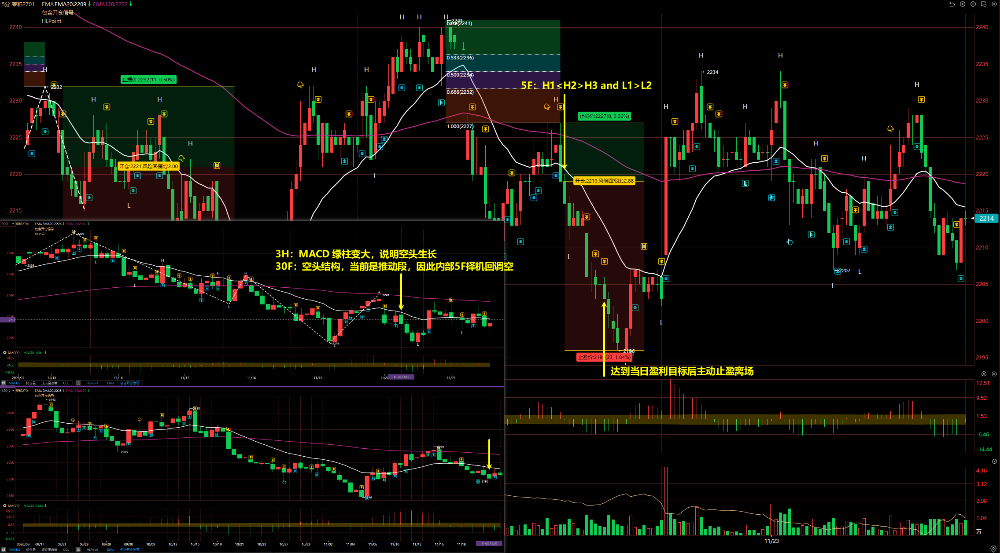
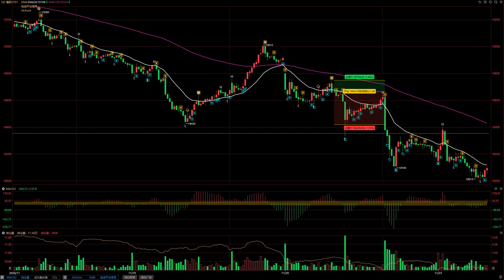
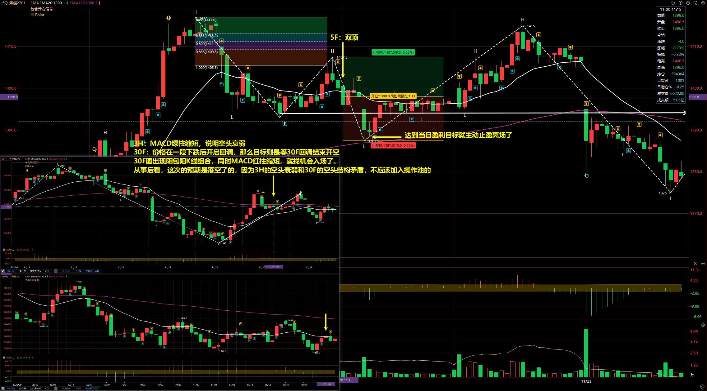

# 2026/11/20

## 烧碱 2701

3H：MACD 红柱缩短，多头衰竭

30F：价格维持在多头防卫位上方，并非明确的空头结构。3H 和 30F 矛盾，不应该操作的，但我还是操作了。

5F：看到这么强的阴线，我就直接入场了空单了，可惜最终没有走太远，很快就回来了。

## 纸浆 2701

3H：MACD 绿柱变大，说明空头生长

30F：空头结构，当前是趋势回调段，因此等其结束开空

5F：30F 看到阴包阳就开仓，其实可以再等等的，等 5F 回调结束开多会更好

## 菜油 2701

3H：MACD 绿柱变大，说明空头生长

30F：空头结构，当前是趋势回调段，因此等其结束开空

5F：看到这根收盘的阴线开仓的空单，觉得 5F 回调结束了。刚开完仓，就迎来一根大阳线浮亏，随后开启了扛单。

## 菜粕 2701

3H：MACD 绿柱变大，说明空头生长

30F：空头结构，当前是推动段，因此内部 5F 择机回调空

5F：H1 < H2 > H3 and L1 > L2

## 橡胶 2701

3H：MACD 绿柱变大，说明空头生长

30F：空头结构，当前是推动段，因此内部 5F 择机回调空

5F：H1 > H2 > H3 and L1 > L2，非常标准的空头结构

这笔交易没啥说的，就是非常顺利的预期走势。

## 焦煤 2701

3H：MACD 绿柱缩短，说明空头衰弱

30F：价格在一段下跌后开启回调，那么目标则是等 30F 回调结束开空

30F 图出现阴包阳 K 线组合，同时 MACD 红柱缩短，就找机会入场了。

5F：双顶

::: danger

从事后看，这次的预期是落空了的，因为 3H 的空头衰弱和 30F 的空头结构矛盾，不应该加入操作池的。

:::

