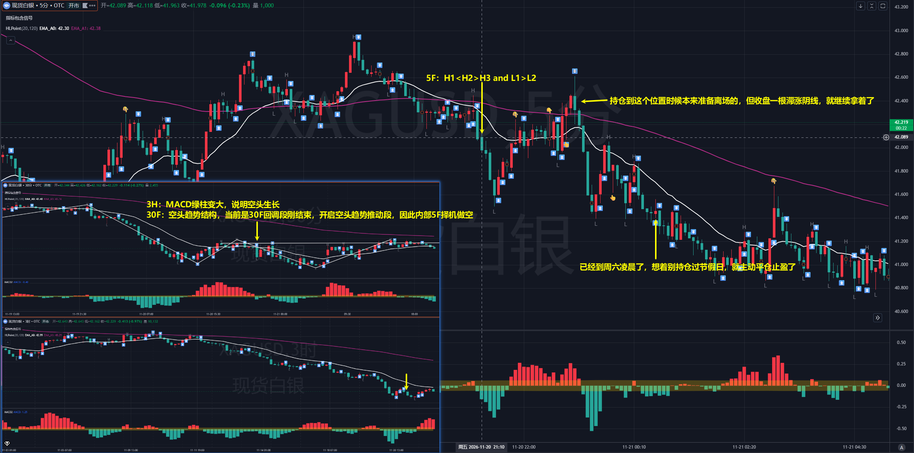
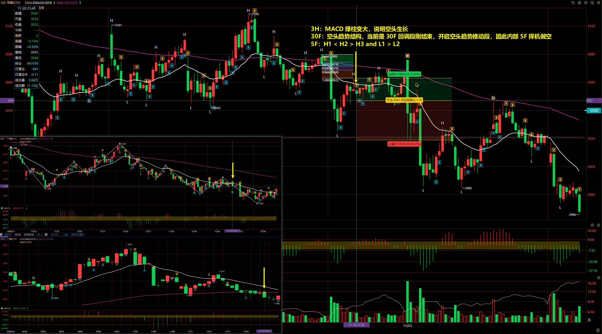

# 2026/11/23

## 沪银 2702

3H：MACD 绿柱变大，说明空头生长

30F：空头趋势结构，当前是 30F 回调段刚结束，开启空头趋势推动段，因此内部 5F 择机做空

5F：H1 < H2 > H3 and L1 > L2

## 甲醇 2701

3H：MACD 绿柱变大，说明空头生长

30F：空头趋势结构，当前是 30F 回调段刚结束，开启空头趋势推动段，因此内部 5F 择机做空

5F：H1 < H2 > H3 and L1 > L2

