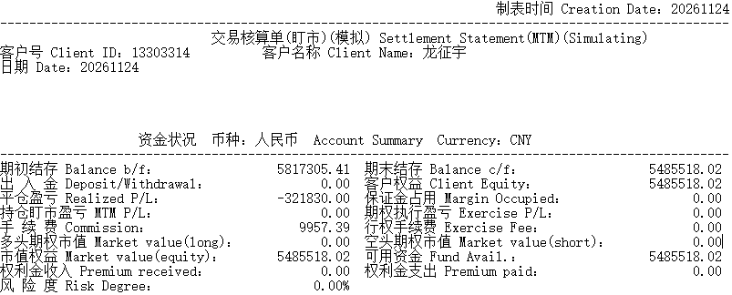
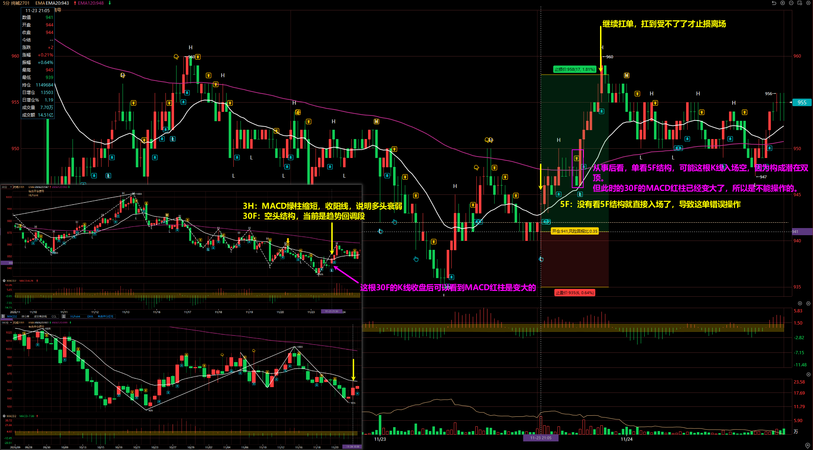
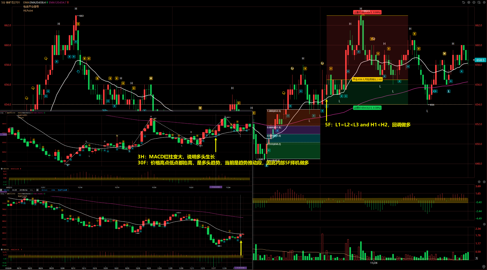
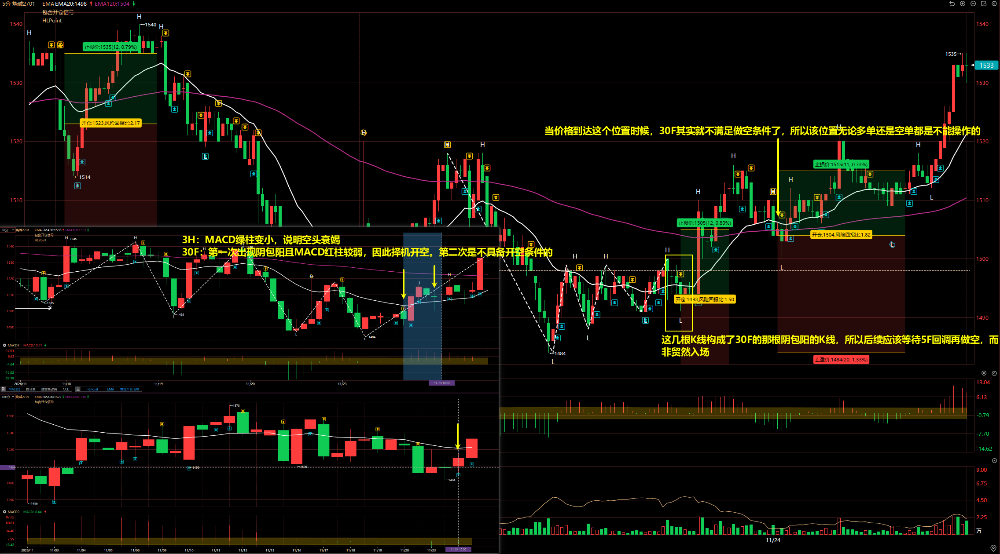
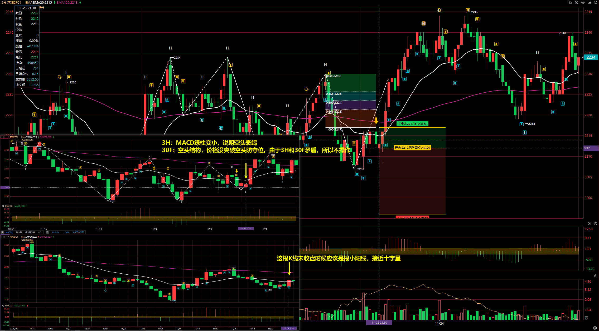
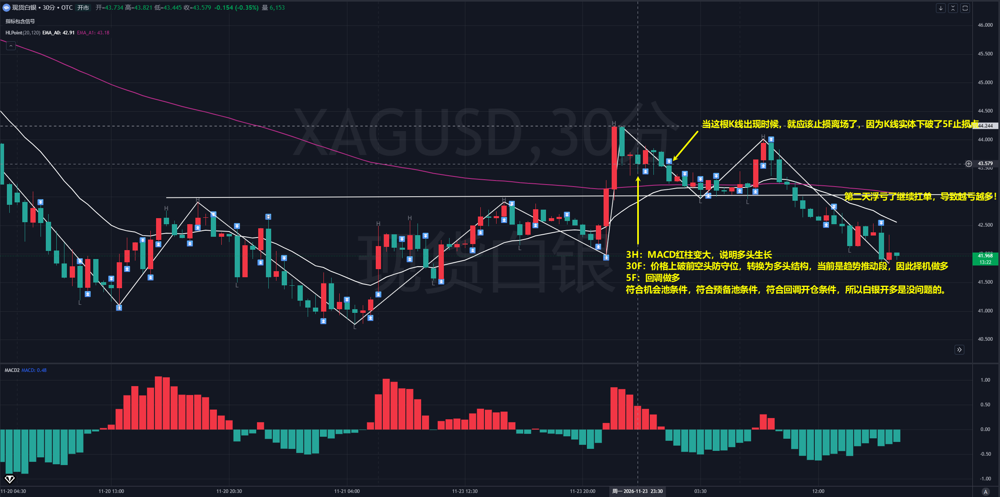
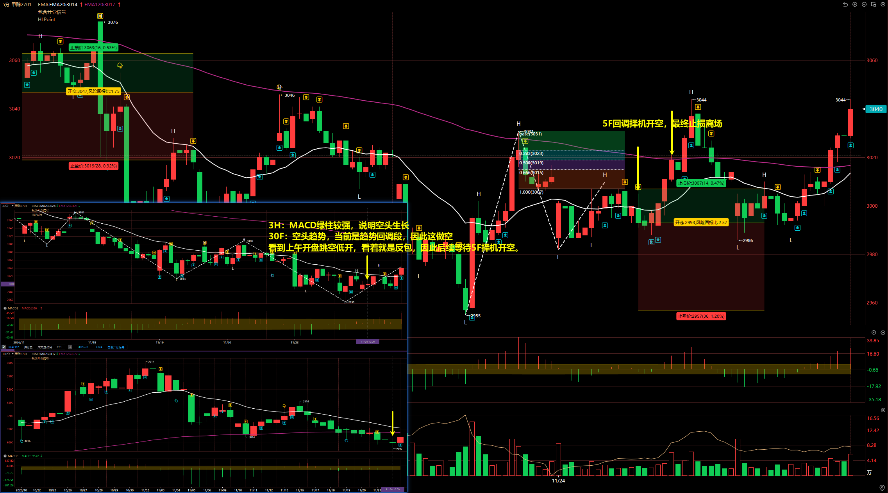

# 2026/11/24

## ⭐今日反思

今天做的是一坨狗屎，回撤估计快 6%了，一天啊，回撤了这么多，前面的努力都白费了！一个个复盘看看吧，很多都是不应该的操作。这个账户接近报废了，晚上只能做一个品种了，如果能浮盈这个账户也许还能拯救下，如果不能浮盈这个模拟考核账户算是废掉了。

然后从借呗立马借了 2 万，加上手上是 5 千，凑成 2.5 万放进实盘账户，再试试吧。经过长时间的模拟操作，系统本身已经没啥问题了，现在就是执行力的问题了。

操作上看，纯碱、2 次烧碱、菜粕都是不该入场的，不符合开仓结构，这 4 次交易都是不应该的。而铁矿石、白银、甲醇是开仓没问题的，但白银随后走弱没有及时平仓离场，而是选择了扛单，导致白银爆亏！甲醇是符合开空的，这个是最终挂单止损离场，没啥问题，需要优化的是如何减少每次止损亏损量。

## 纯碱 2701

3H：MACD 绿柱缩短，收阳线，说明多头衰弱

30F：空头结构，当前是趋势回调段

5F：不符合开仓结构，就直接入场了

从事后看，单看 5F 结构，某些仍可能入场空，因为构成潜在双顶。但此时的 30F 的 MACD 红柱已经变大了，所以是不能操作的。

## 铁矿石 2701

3H：MACD 红柱变大，说明多头生长

30F：价格高点低点都抬高，是多头趋势，当前是趋势推动段，因此内部 5F 择机做多

5F：L1 = L2 < L3 and H1 < H2，回调做多

## 烧碱 2701

3H：MACD 绿柱变小，说明空头衰竭

30F：第一次出现阴包阳且 MACD 红柱较弱，因此择机开空。第二次是不具备开空条件的。

烧碱今天亏的非常多，第一次是符合进入备选池的，因为 30F 出现阴包阳且 MACD 红柱较弱的结构，但第 ③ 步等待回调时候很明显是没有耐心的，匆匆忙忙就入场了，从时候看如果等待 5F 回调，肯定是不会入场的，因为 5F 压根没有给机会。

第二次是没有进入备选池的，因为 30F 的阳线是非常强的，没有出现反包的阴线，此时和 5F 没关系，多单空单都是不能操作的。

## 菜粕 2701

3H：MACD 绿柱变小，说明空头衰竭

30F：空头结构，价格没突破空头防守位。由于 3H 和 30F 矛盾，所以不操作

从事后看，菜粕是不该操作的，因为 3H 和 30F 矛盾，没有进入预备池，多单空头都不能操作。

## 沪银 2702

3H：MACD 红柱变大，说明多头生长

30F：价格上破前空头防守位，转换为多头结构，当前是趋势推动段，因此择机做多

5F：回调做多

符合机会池条件，符合预备池条件，符合回调开仓条件，所以白银开多是没问题的。

**入场没问题，问题在于没有及时止损，而是扛单，导致亏损越来越大。**

## 甲醇 2701

3H：MACD 绿柱较强，说明空头生长

30F：空头趋势结构，当前是趋势回调段，因此择机做空

看到上午开盘跳空低开，构成反包 K 线组合，因此就等待 5F 择机开空。

