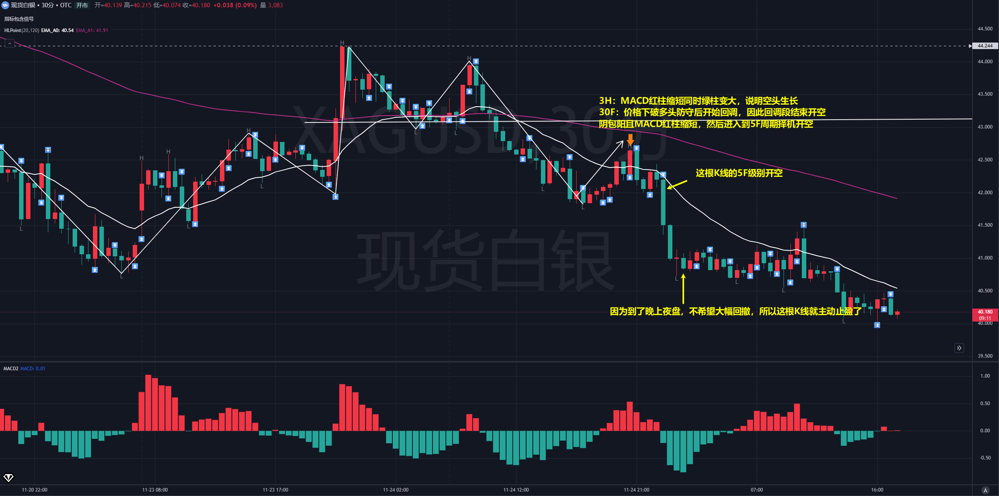
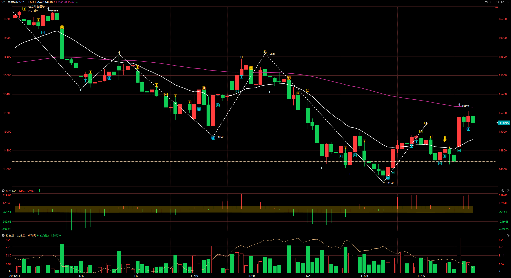
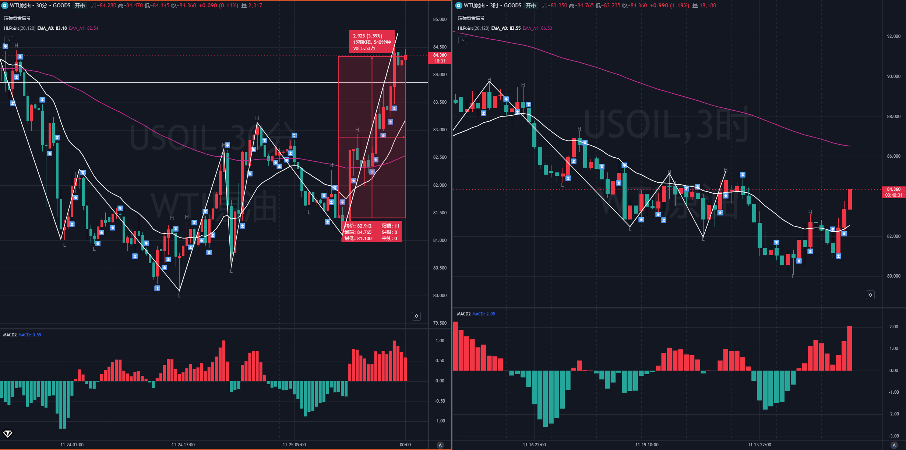

# 2026/11/25

## 实盘账户权益

今天主要做的玻璃，然后止损亏损 1200，另外开仓了鸡蛋的空单，晚上不用操作。

## 玻璃 2701

3H：MACD 绿柱较大，但在缩短，仍旧是按照空头生长对待

30F：空头趋势，当前是趋势回调段，因此择机做空

可以看到出现阴包阳 K 线同时 MACD 红柱缩短，所以可尝试做空

5F：双顶，于是直接开空了

## 沪银 2702

3H：MACD 红柱缩短同时绿柱变大，说明空头生长

30F：价格下破多头防守后开始回调，因此回调段结束开空

阴包阳且 MACD 红柱缩短，然后进入到 5F 周期择机开空

离场：因为到了晚上夜盘，不希望大幅回撤，所以这根 K 线就主动止盈了

## 合成橡胶 2701 <Badge type="danger" text="黑天鹅" />

箭头位置是开空位置，很明显 3H 的 MACD 本来就是绿柱较大，说明空头强势应该以做空视角操作。30F 是空头趋势的趋势回调段，因此今天下午的时候 5F 回调做空，开仓是没有问题的，而且开仓后有 0.6%的浮盈。

但很可惜夜盘合成橡胶在 5F 瞬间高开高走，一度暴涨 3%+，所以考核账户就直接爆了。

这是因为外盘的原油在下午 15:00 后暴涨，所以带动合成橡胶、甲醇、乙二醇、PTA 等品种也暴涨。

::: danger

操作原油系、有色相关品种时候，最好晚上收盘前、下午收盘前平仓离场。如果是自己的实盘账户，我觉得最好别操作原油系和有色相关的，除非是内盘盘中的不错机会。

:::

