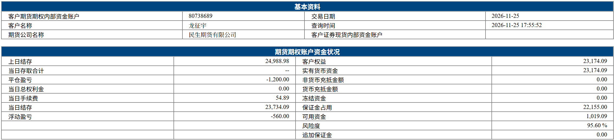
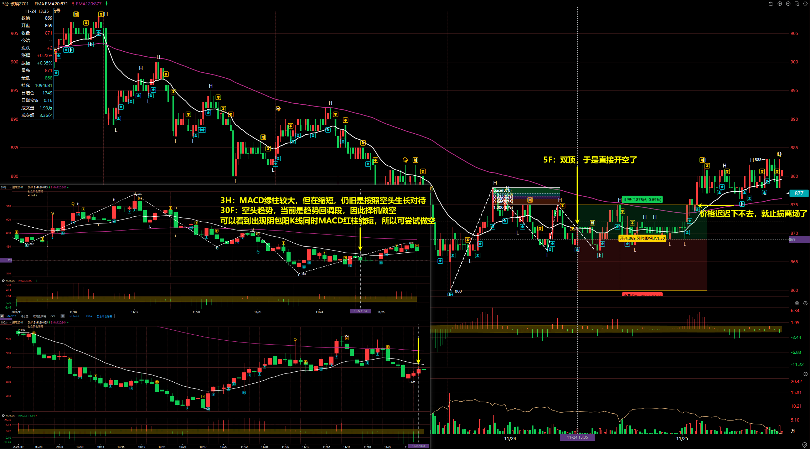

# 2026/11/25

## 实盘账户权益

今天主要做的玻璃，然后止损亏损 1200，另外开仓了鸡蛋的空单，晚上不用操作。

## 玻璃 2701

3H：MACD 绿柱较大，但在缩短，仍旧是按照空头生长对待

30F：空头趋势，当前是趋势回调段，因此择机做空

可以看到出现阴包阳 K 线同时 MACD 红柱缩短，所以可尝试做空

5F：双顶，于是直接开空了

## 沪银 2702

3H：MACD 红柱缩短同时绿柱变大，说明空头生长

30F：价格下破多头防守后开始回调，因此回调段结束开空

阴包阳且 MACD 红柱缩短，然后进入到 5F 周期择机开空

离场：因为到了晚上夜盘，不希望大幅回撤，所以这根 K 线就主动止盈了

